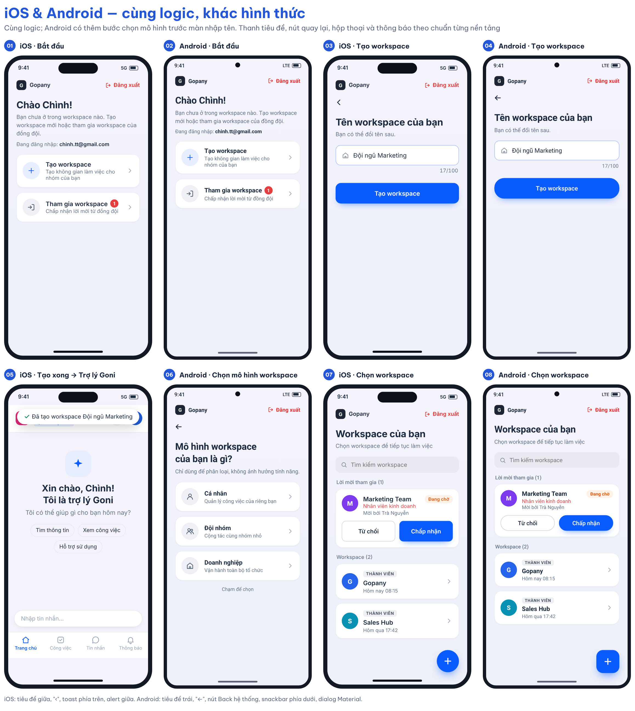

# 00 [EPIC-WS] Tổng quan – Mở lại tạo workspace trên iOS & làm lại theo design mới

> **Tóm tắt:** Gom hướng mới của PM thành 4 user story cho iOS & Android, bám logic web *Workspace ver 2.1*; chỉ rõ chỗ khác với bản draft 21/10 và các điểm cần PM chốt · **Nền tảng:** Android, iOS · **Wireframe:** `gopany-wireframe-workspace-mobile.html` (bấm thử được) · **Trạng thái:** Draft – gửi PM review

**Người thực hiện:** TTS BA Tướng Thị Chình · **Ngày cập nhật:** 29/10/2026 · **Người review:** PM

**Nguyên tắc:** App dùng **cùng logic với web** (file *Workspace ver 2.1*: sheet UserStory và MTDL). Chỗ nào app khác web chỉ là cách trình bày cho màn hình điện thoại, hoặc là yêu cầu mới của PM; các chỗ này được liệt kê ở mục 4.

## 1. Đầu việc PM giao

**Bối cảnh**

* iOS đang ẩn tạo workspace vì từng bị Apple reject (3.1.1). User chưa có workspace bị kẹt ở màn "Bạn chưa có Workspace nào".
* Android có luồng tạo nhưng theo design cũ.
* Design cũ: bước Cá nhân/Đội nhóm/Doanh nghiệp nhìn giống chọn gói; có nhắc "lời mời" nhưng không có chỗ xem; màn danh sách không có nút tạo mới; thiếu loading/lỗi.

**Hướng PM đề xuất (chưa chốt)**

1. Màn trống có 2 lựa chọn: **Tạo workspace** / **Tham gia workspace** + hiện lời mời đang chờ.
2. Tạo workspace chỉ **1 màn nhập tên**.
3. ~~Tạo xong thì mời thành viên (bỏ qua được) rồi vào thẳng app.~~ → **Đã bỏ (29/10):** tạo xong vào thẳng app, không có bước mời.
4. Người được admin thêm thì **vào thẳng workspace**, không thấy màn trống.
5. iOS **không hiện gói/giá/link thanh toán**.

**Cập nhật 29/10:** Đang làm **US1 Tạo workspace** và **US2 Hiển thị danh sách lời mời** (thay US3 cũ). US2 cũ (Mời thành viên sau khi tạo) đã bỏ vì không còn bước mời trong luồng tạo; US3 cũ và US2 cũ chuyển vào thư mục `_luu-tru/`. US4 chờ làm sau. Màn Bắt đầu chỉ có thẻ Tạo workspace; lời mời chỉ hiện ở màn Chọn workspace và danh sách workspace trong app. Android **vẫn giữ** bước chọn mô hình (Cá nhân/Đội nhóm/Doanh nghiệp), iOS bỏ.

**Thông tin bổ sung (29/10):** Trên web, người dùng tham gia workspace bằng cách mở email mời và bấm link. Hệ thống chưa có mã tham gia hay link tham gia dùng chung. App dựa trên logic web *Workspace ver 2.1*.

## 2. Bộ user story

| US mobile | Tên | Đáp ứng ý PM | Logic web tương ứng | Trạng thái |
|-----------|-----|--------------|---------------------|------------|
| [US1](../01-epic-ws-us1-tao-workspace/01-epic-ws-us1-tao-workspace.md) | Tạo workspace | 2, 5 | US-WS-02, US-WS-04, quy tắc A25, MTDL tên workspace | **Đang làm** – v2.9 |
| [US2](../02-epic-ws-us2-hien-thi-danh-sach-loi-moi/02-epic-ws-us2-hien-thi-danh-sach-loi-moi.md) | Hiển thị danh sách lời mời (xem & xử lý) | 1 | US-WS-05, 07B, 10, 11, 12, 13, 15, A7, A26 | **Đang làm** – v1 |
| [US4](../04-epic-ws-us4-dieu-huong-sau-dang-nhap/04-epic-ws-us4-dieu-huong-sau-dang-nhap.md) | Điều hướng sau đăng nhập & màn "Bắt đầu" | 1, 4 | US-WS-01, 02, 03, 04, 06, 07A, 09, quy tắc A24 | Chờ làm sau |

Luồng tạo (US1): **Nút Tạo workspace (3 trường hợp) → [Android: chọn mô hình] → nhập tên → tạo → Trợ lý Goni**.

Luồng tổng (khi làm đủ epic): Đăng nhập → US4 xác định điểm vào → (chưa có workspace) màn Bắt đầu → US1 Tạo → Trợ lý Goni, (chưa có workspace thì tham gia bằng link trong email). Người đã có workspace và còn lời mời → US2: lời mời ở màn Chọn workspace hoặc badge + danh sách workspace trong app → Chấp nhận → vào workspace.

Bản 21/10 được giữ nguyên tại thư mục `_ban-truoc-29-10/` để đối chiếu.

## 3. Đối chiếu với logic web (Workspace ver 2.1)

| Logic web | Nội dung trên web | Bản mobile trước khi đối chiếu | Đã chỉnh theo web |
|-----------|-------------------|-------------------------------|-------------------|
| US-WS-01 | 0 workspace → màn khởi tạo; 1 → vào thẳng; ≥ 2 → màn chọn workspace; lỗi tải → báo lỗi | Khớp | Giữ nguyên (US4) |
| A24, A7, US-WS-12 | Có 1 workspace thì vào thẳng, không hiện màn chọn. Còn lời mời → **popup xác nhận trên trang thao tác**, hiện lại khi tải lại trang | Đề xuất vào thẳng + chỉ hiện badge (Q1) | Vào thẳng; lời mời hiện bằng **badge + danh sách**, **không dùng popup** (quyết định 29/10, xem mục 4) |
| US-WS-03 | Màn chọn workspace **không xử lý tạo workspace** | Có dòng "+ Tạo workspace" ở màn Chọn | **Giữ** + Tạo workspace khi chưa có workspace Admin – quyết định PM 29/10, khác web (mục 4) |
| A25 | Người đã ở trong hệ thống tạo workspace riêng **qua switcher trong app**, không ở luồng đăng nhập | Khớp | Giữ "+ Tạo workspace" trên màn danh sách workspace (switcher) |
| US-WS-04 | Cập nhật context lỗi → thử lại **hoặc chọn workspace khác** | Chỉ có Thử mở lại | Bổ sung "Chọn workspace khác" khi còn workspace khác (US1) |
| A7, US-WS-10 | Đồng ý → **chuyển sang workspace B ở trang chào mừng**. Không đồng ý → ở lại, **lời mời mất hiệu lực** | Từ switcher: ở lại + nút Mở (Q7) | Chấp nhận ở bất kỳ đâu → chuyển sang workspace B. Q7 đã chốt theo web (US3) |
| US-WS-13 | Nhiều lời mời: hiện **từ mới đến cũ, lần lượt**; bỏ qua lời mời hết hiệu lực | Danh sách mới nhất trước | Danh sách mới → cũ; **không popup lần lượt** (US3) |
| US-WS-14 | Popup chưa thao tác mà tắt app/tải lại → **hiện lại**, không tự tham gia | Chỉ tải lại khi quay lại app | Không áp dụng (app không dùng popup); mở lại app thì badge và danh sách vẫn còn lời mời, không tự tham gia (US3) |
| US-WS-11 | Sai email: "Bạn đang đăng nhập bằng tài khoản email A, lời mời tham gia workspace được gửi tới email B, được mời bởi … Chọn đăng nhập với mail B hoặc ở lại" | Mô tả chung | Không áp dụng trên app: danh sách chỉ hiện lời mời gửi tới email đang đăng nhập (US2 v1.1) |
| US-WS-12, 15 | Lời mời hiệu lực **24 giờ**. Hết hạn/thu hồi/đã xử lý: "Trang này không khả dụng. Bạn không có quyền truy cập vào không gian làm việc này hoặc không gian làm việc này không còn tồn tại" | "Lời mời không còn khả dụng." | Dùng đúng câu web (US3) |
| US-WS-09 | Chuyển workspace: **cảnh báo dữ liệu chưa lưu**, người dùng xác nhận; lỗi thì giữ workspace hiện tại | Wireframe chuyển ngay | Thêm hộp xác nhận khi chuyển từ switcher (US4) |
| A27 | Mời đồng thời từ DSNS và SĐCCTC, **check trùng email đã mời**; **một email chỉ gán 1 chức vụ** | US2 chưa có chức vụ | US2: mỗi email mời gắn 1 chức vụ; check trùng với lời mời từ mọi nguồn (US2 đang tạm dừng) |
| MTDL | Tên workspace tối đa 100 ký tự, lỗi "Tên workspace không được vượt quá 100 ký tự" | Khớp | Giữ nguyên (US1) |
| US-WS-05, 06, 07A, 07B | Link mời, tạo mật khẩu, kích hoạt nhanh → vào thẳng workspace được mời | Khớp (US4 bảng điểm vào) | Giữ nguyên; các màn tạo mật khẩu/kích hoạt thuộc luồng đăng nhập, ngoài epic này |

## 4. Chỗ app khác web (cần PM xác nhận)

| # | App | Web | Lý do |
|---|-----|-----|-------|
| 1 | Màn **Bắt đầu** có 2 thẻ Tạo / Tham gia; bấm Tham gia mở **màn Tham gia workspace** chứa danh sách lời mời | Màn khởi tạo + popup lời mời | Hướng PM. Hành động Đồng ý/Không đồng ý, thứ tự mới → cũ, thông báo lỗi giữ như web. Màn Bắt đầu không hiển thị danh sách và không bật popup |
| 2 | ~~Bước Mời thành viên ngay sau khi tạo~~ – **đã bỏ (29/10)**, tạo xong vào thẳng Trợ lý Goni | Web không có bước này | Nay khớp web |
| 6 | Bước chọn mô hình (Cá nhân/Đội nhóm/Doanh nghiệp): **iOS bỏ, Android giữ** | Theo hiện trạng web | iOS bỏ vì rủi ro Apple 3.1.1; Android giữ theo quyết định 29/10 |
| 3 | iOS không có gói, giá, nâng cấp, link thanh toán | Web có thể hiển thị | Apple 3.1.1 |
| 4 | **Không dùng popup lời mời**; lời mời hiện bằng badge + danh sách (màn Lời mời tham gia, màn Chọn workspace, danh sách workspace trong app) | Popup xác nhận lần lượt, hiện lại khi tải lại trang (A7, US-WS-12/13/14) | Quyết định 29/10. Hành động Chấp nhận/Từ chối, thông báo lỗi, thứ tự mới → cũ giữ như web |
| 5 | Màn Chọn workspace có **+ Tạo workspace** khi đăng nhập có ≥ 2 workspace mà tất cả đều vai trò Thành viên | Màn chọn workspace không xử lý tạo (US-WS-03) | Quyết định PM 29/10: người chỉ là thành viên ở nhiều workspace cần thấy điểm tạo ngay khi đăng nhập |

## 5. Nguyên tắc iOS – tránh bị reject lại theo 3.1.1

Guideline 3.1.1 yêu cầu: tính năng mở khoá trong app phải dùng In-App Purchase, và app **không được có nút, link hay lời kêu gọi** dẫn người dùng đến cách mua khác ngoài In-App Purchase. Tạo workspace là miễn phí nên tự nó không vi phạm. Rủi ro nằm ở những gì **trông giống** bán gói hoặc dẫn ra ngoài để mua.

**Checklist áp dụng cho mọi màn trong epic (iOS bắt buộc; Android áp dụng mục 2–6, riêng mục 1 Android vẫn giữ bước chọn mô hình):**

| # | Không được có trên iOS | Thay bằng |
|---|------------------------|-----------|
| 1 | Bước/thẻ chọn Cá nhân/Đội nhóm/Doanh nghiệp, hoặc bất kỳ lựa chọn kiểu "gói" nào | Chỉ nhập tên |
| 2 | Tên gói (Free, Pro, Business…), giá, "dùng thử", so sánh quyền lợi | Không hiển thị |
| 3 | Nút "Nâng cấp", "Mua thêm chỗ", "Liên hệ để mua" | Không hiển thị |
| 4 | Link hoặc lời hướng dẫn lên web để nâng cấp/thanh toán | Không hiển thị |
| 5 | Thông báo giới hạn có gợi ý mua | Thông báo trung tính, ví dụ "Workspace này đã đủ thành viên." |
| 6 | Badge/nhãn gói trong danh sách workspace, switcher | Chỉ nhãn vai trò: Quản trị viên / Thành viên |

**Đề xuất cho lần nộp lại (PM/Dev quyết định):**

* Ghi chú cho App Review: tạo workspace miễn phí, không có nội dung trả phí được bán trong app; kèm tài khoản demo chưa có workspace để reviewer đi hết luồng Tạo → vào app.
* Apple review **toàn bộ app**, không chỉ luồng này. Nên rà thêm các màn ngoài epic (Cài đặt, Hồ sơ, Nhân sự…) xem còn chữ "gói", "nâng cấp", giá hay link web không.
* Cần bản phản hồi gốc của Apple lần reject trước để đối chiếu đúng điểm bị bắt (đã có ở Open Question US1).

## 6. Một design cho iOS & Android

Wireframe theo design tham khảo của team (29/10): thanh trên cùng có logo Gopany và Đăng xuất, tiêu đề lớn, mỗi workspace/lời mời là một thẻ riêng, màn Chọn workspace có ô tìm kiếm và nút + nổi, màn đặt tên có icon trong ô nhập. Bước "Mô hình workspace của bạn là gì?" (Cá nhân/Đội nhóm/Doanh nghiệp) trong design tham khảo: **iOS không dùng** (dễ bị Apple hiểu là chọn gói); **Android vẫn dùng**, hiện trước màn nhập tên (US1 BR5).

Hai nền tảng dùng chung logic, nội dung và trạng thái, trừ bước chọn mô hình chỉ có trên Android. Còn lại chỉ khác hình thức theo chuẩn từng hệ điều hành: thanh tiêu đề, nút quay lại, hộp thoại và kiểu thông báo. Android có nút Back hệ thống: ở màn nhập tên, Back về màn chọn mô hình.

 

Wireframe bấm thử: mở `gopany-wireframe-workspace-mobile.html`. Có 2 tab: **Tạo workspace** (3 tình huống TH1–TH3 của US1; Android qua bước chọn mô hình; tạo xong vào Trợ lý Goni) và **Lời mời** (4 tình huống xem và xử lý lời mời). Mỗi tab có ô giả lập lỗi riêng.

## 7. Câu hỏi cần PM chốt

**Đã chốt theo logic web (29/10):**

| # | Câu hỏi | Kết quả |
|---|---------|---------|
| Q1 | Có 1 workspace và có lời mời mới: vào thẳng hay màn chọn? | Vào thẳng workspace; lời mời hiện bằng badge + danh sách, không popup (quyết định 29/10) |
| Q2 | Có ≥ 2 workspace: nhớ workspace gần nhất hay màn chọn? | Màn chọn workspace (US-WS-01) |
| Q7 | Chấp nhận lời mời khi đang ở workspace khác: ở lại hay chuyển? | Chuyển sang workspace được mời, mở trang chào mừng (A7, US-WS-10) |

**Còn mở:**

| # | Câu hỏi | Đề xuất của BA | US |
|---|---------|----------------|----|
| Q3 | Tài khoản đăng ký bằng SĐT, chưa có email, có nhận được lời mời không? (lời mời gửi qua email) | Cần anh Chiến xác nhận; nếu không, màn hướng dẫn Tham gia cần nhắc bổ sung email | US2, US4 |
| Q4 | Link mời mở trên điện thoại sẽ mở app (deep link) hay mở web? | Cần Dev xác nhận; nếu mở web thì vẫn đúng, chỉ cần app tải lại danh sách khi quay lại | US2 |
| Q8 | Android có hiển thị gói/nâng cấp không, hay dùng chung bản trung tính với iOS? | Dùng chung bản trung tính | Tất cả |
| Q9 | Validation tên: bắt buộc, độ dài tối thiểu, trim khoảng trắng, cách đếm emoji (file web chỉ quy định tối đa 100) | Bắt buộc; trim đầu/cuối; tối thiểu 1 ký tự sau trim; đếm theo ký tự hiển thị | US1 |
| Q10 | "Trang chào mừng" của web tương ứng màn nào trên app? | Màn Trợ lý Goni của workspace | US1, US2 |
| Q11 | Các điểm app khác web ở mục 4 có được chấp nhận? | Có | Tất cả |
| Q12 | Android giữ bước chọn mô hình: giá trị mô hình có lưu cùng workspace không? Workspace tạo trên iOS để trống hay gán mặc định? | Lưu nếu hệ thống đang có trường này; iOS để trống, không ảnh hưởng tính năng | US1 |

**Tạm dừng cùng US2 (bước mời đã bỏ khỏi luồng tạo):** Q5 (mời bằng email hay SĐT, tối đa bao nhiêu người/lần), Q6 (chức vụ mặc định khi mời).

## 8. Lịch sử thay đổi

| Ngày | Nội dung thay đổi |
|------|-------------------|
| 21/10/2026 | Draft US1, US3 và hiện trạng hệ thống |
| 29/10/2026 | Làm lại theo hướng mới của PM: thêm US2, US4, cập nhật US1, US3, wireframe iOS & Android |
| 29/10/2026 | Đối chiếu logic web *Workspace ver 2.1*: chốt Q1, Q2, Q7; bỏ Tạo ở màn Chọn workspace; popup lời mời in-app; câu thông báo theo web; xác nhận khi chuyển workspace; chức vụ khi mời; thêm Q10, Q11 |
| 29/10/2026 | Chốt điểm vào Tạo workspace: màn Bắt đầu (0 workspace), màn Chọn workspace (≥ 2 workspace đều là Thành viên), màn danh sách workspace trong app – chỉ khi chưa có workspace Admin |
| 29/10/2026 | Rút gọn điểm vào Tạo workspace còn 3 trường hợp: đăng ký; mở màn danh sách workspace; đăng nhập có từ 2 workspace không có vai trò Admin (US1) |
| 29/10/2026 | Bỏ danh sách lời mời khỏi màn Bắt đầu; danh sách nằm trong màn Tham gia workspace (US3, US4) |
| 29/10/2026 | Làm lại wireframe theo design tham khảo của team; không dùng bước chọn mô hình workspace |
| 29/10/2026 | Bỏ popup lời mời tự bật và hiện lần lượt; lời mời trong app chỉ dùng badge + danh sách (US3, US4) |
| 29/10/2026 | Chỉ làm luồng tạo (US1); Android giữ bước chọn mô hình, iOS bỏ; bỏ bước Mời thành viên khỏi luồng tạo – US2 tạm dừng, Q5, Q6 tạm dừng; thêm Q12 và cột Trạng thái cho bộ US |
| 29/10/2026 | US2 mới: Hiển thị danh sách lời mời (thay US3 cũ); bỏ US2 cũ Mời thành viên; US2 cũ và US3 cũ chuyển vào `_luu-tru/` |
