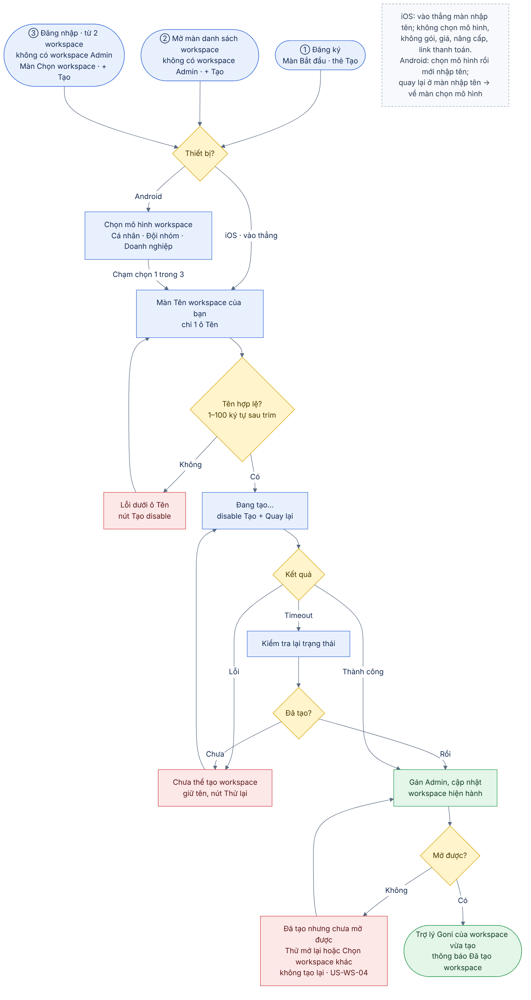
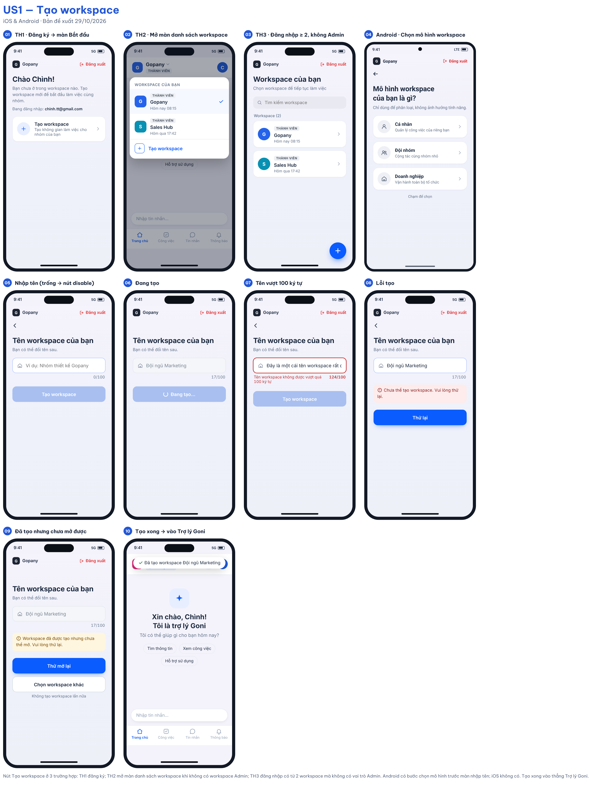

# 01 [EPIC-WS] US1 – Tạo workspace

> **Tóm tắt:** Mở lại tạo workspace trên iOS, làm lại trên Android theo design mới; nút Tạo workspace ở 3 trường hợp: đăng ký, mở màn danh sách workspace, đăng nhập có từ 2 workspace mà không có vai trò Admin; iOS chỉ 1 màn nhập tên, Android giữ bước chọn mô hình (Cá nhân/Đội nhóm/Doanh nghiệp) trước màn nhập tên; tạo xong vào thẳng Trợ lý Goni của workspace vừa tạo; đầy đủ trạng thái xử lý · **Nền tảng:** Android, iOS · **Wireframe:** `gopany-wireframe-workspace-mobile.html` (tab Tạo workspace) · **Số AC:** 15 · **Priority:** High – đề xuất · **Logic web:** US-WS-02, US-WS-04, A25, MTDL

**Trạng thái:** Draft v2.9 (29/10/2026) – chờ PM review. Đã đối chiếu logic web *Workspace ver 2.1*. Phạm vi tài liệu: chỉ luồng tạo workspace.

## 1. Background

iOS đang ẩn tạo workspace sau lần Apple reject theo mục 3.1.1, khiến người chưa có workspace bị kẹt tại màn "Bạn chưa có Workspace nào". Android có luồng theo design cũ. Màn danh sách thiếu nút tạo mới; thiếu loading/lỗi. Bước Cá nhân/Đội nhóm/Doanh nghiệp nhìn giống chọn gói.

Anh Chiến xác nhận bỏ bước chọn mô hình không ảnh hưởng logic hoặc workspace hiện có. Quyền lợi theo gói dịch vụ. Theo cập nhật của Chình dựa trên thông tin chị Trà cung cấp, điều kiện tạo được xác định bằng việc tài khoản có workspace mang vai trò Admin hay chưa, vì hiện chưa có cơ chế gán quyền.

Luồng tạo sau khi làm lại:

* **iOS:** Nút Tạo workspace → màn nhập tên → tạo → Trợ lý Goni.
* **Android:** Nút Tạo workspace → **chọn mô hình workspace** (Cá nhân/Đội nhóm/Doanh nghiệp) → màn nhập tên → tạo → Trợ lý Goni.

Luồng tạo không có bước mời thành viên (chốt 29/10); Admin mời sau ở màn Nhân sự/Sơ đồ tổ chức như hiện có. Bước chọn mô hình chỉ bỏ trên iOS vì nhìn giống chọn gói (rủi ro Apple 3.1.1); Android vẫn giữ (chốt 29/10).

## 2. User Story

Là **người dùng chưa có workspace nào mang vai trò Admin**, tôi muốn **tạo workspace chỉ bằng cách nhập tên**, để **có workspace do mình quản trị, mời đồng đội và bắt đầu làm việc ngay trên điện thoại**.

## 3. Scope

**Trong phạm vi:**

* Nút Tạo workspace ở 3 trường hợp – xem bảng ở mục 5.
* Kiểm tra điều kiện tạo theo vai trò Admin.
* Mở lại trên iOS, làm lại trên Android theo cùng một design.
* Bỏ bước chọn Cá nhân/Đội nhóm/Doanh nghiệp trên iOS; Android giữ bước này trước màn nhập tên.
* Màn nhập tên; tạo; gán người tạo là Admin; cập nhật workspace hiện hành; mở Trợ lý Goni của workspace vừa tạo.
* Loading, validation, lỗi, timeout và thử lại.
* Không hiển thị gói, giá, nâng cấp, link thanh toán trên iOS (BR12).

**Ngoài phạm vi:** Bước mời thành viên ngay sau khi tạo (đã bỏ khỏi luồng tạo); các luồng khác của epic (xem/xử lý lời mời, điều hướng sau đăng nhập) – làm sau; thay đổi gói/giới hạn thành viên; chia sẻ Zalo; cơ chế gán quyền; cho phép tạo nhiều workspace quản trị.

## 4. User flow

 

Một luồng chung cho cả hai nền tảng. Sau khi bấm Tạo workspace (ở 1 trong 3 trường hợp), hệ thống kiểm tra thiết bị:

* **iOS:** vào thẳng màn nhập tên workspace.
* **Android:** hiển thị màn chọn mô hình workspace (Cá nhân/Đội nhóm/Doanh nghiệp) trước, chạm chọn 1 trong 3 rồi mới đến màn nhập tên; quay lại ở màn nhập tên thì về màn chọn mô hình.

Từ màn nhập tên trở đi (kiểm tra tên, tạo, xử lý lỗi, vào Trợ lý Goni) hai nền tảng giống nhau.

## 5. Wireframe

 

**Nút Tạo workspace – 3 trường hợp (chốt 29/10):**

| # | Trường hợp | Điều kiện | Nút Tạo nằm ở |
|---|------------|-----------|---------------|
| 1 | Đăng ký | Đăng ký thành công, chưa có workspace | Thẻ **Tạo workspace** trên màn Bắt đầu |
| 2 | Mở màn danh sách workspace | Không có workspace nào vai trò Admin | Dòng **+ Tạo workspace** cuối danh sách |
| 3 | Đăng nhập | Có từ 2 workspace, không có workspace nào vai trò Admin | Nút **+** nổi góc dưới phải màn Chọn workspace |

Trường hợp 3 khác file web (US-WS-03 ghi màn chọn workspace không xử lý tạo) – theo quyết định PM 29/10.

| Màn/trạng thái | Nội dung |
|----------------|----------|
| Trường hợp 1 · màn Bắt đầu | Lời chào, dòng "Bạn chưa ở trong workspace nào. Tạo workspace mới để bắt đầu làm việc cùng nhóm.", email đang đăng nhập; chỉ có thẻ **Tạo workspace** – "Tạo không gian làm việc cho nhóm của bạn" (icon +, mũi tên phải). **Không có thẻ Tham gia workspace.** |
| Trường hợp 2 · màn danh sách workspace | Dòng **+ Tạo workspace** cuối danh sách workspace. |
| Trường hợp 3 · màn Chọn workspace | Nút **+** tròn nổi góc dưới phải, nằm trên danh sách khi cuộn. |
| Android · màn Chọn mô hình workspace | Chỉ có trên Android, hiện ngay sau khi bấm nút Tạo. Thanh trên cùng: logo **Gopany**, **Đăng xuất**. Nút quay lại; tiêu đề "Mô hình workspace của bạn là gì?"; mô tả "Chỉ dùng để phân loại, không ảnh hưởng tính năng."; 3 thẻ: **Cá nhân** – "Quản lý công việc của riêng bạn", **Đội nhóm** – "Cộng tác cùng nhóm nhỏ", **Doanh nghiệp** – "Vận hành toàn bộ tổ chức"; dòng "Chạm để chọn". Chạm một thẻ chuyển sang màn nhập tên. |
| Màn Tạo workspace | Thanh trên cùng: logo **Gopany** bên trái, **Đăng xuất** (chữ đỏ, có icon) bên phải. Nút quay lại; tiêu đề "Tên workspace của bạn"; mô tả "Bạn có thể đổi tên sau."; ô nhập có icon ngôi nhà (placeholder "Ví dụ: Nhóm thiết kế Gopany"); bộ đếm x/100; nút **Tạo workspace** full chiều ngang. iOS: nút quay lại về màn trước nút Tạo. Android: nút quay lại về màn Chọn mô hình. Mở từ trong app (trường hợp 2) thì không hiện Đăng xuất. |
| Đang tạo | Nút đổi thành "Đang tạo…" có spinner, disable; ô tên khoá; nút quay lại khoá. |
| Lỗi tên | Viền đỏ, thông báo dưới ô tên. |
| Lỗi tạo | Banner lỗi trên nút, giữ tên; nút đổi thành **Thử lại**. |
| Đã tạo nhưng chưa mở được | Thông báo "Workspace đã được tạo nhưng chưa thể mở.", nút **Thử mở lại** (không tạo lại) và **Chọn workspace khác** nếu tài khoản còn workspace khác (US-WS-04). |

**Khác biệt nền tảng:** Android có thêm bước chọn mô hình workspace (BR5); còn lại chỉ khác về hình thức: iOS dùng nút quay lại "‹", thông báo dạng toast phía trên; Android dùng nút "←", thông báo dạng snackbar phía dưới, nút Back hệ thống hoạt động như nút quay lại.

## 6. Business Rules

| Mã  | Quy tắc |
|-----|---------|
| BR1 | Tài khoản chưa có workspace nào mang vai trò Admin thì được tạo; đã có ít nhất một workspace mang vai trò Admin thì không được tạo thêm theo phạm vi hiện tại. |
| BR2 | Có workspace với vai trò thành viên hoặc có lời mời chưa xử lý không làm mất điều kiện tạo nếu vẫn đáp ứng BR1. Không tự dùng lịch sử tạo hoặc người tạo ban đầu làm tiêu chí khác. |
| BR3 | Nút Tạo workspace chỉ hiển thị ở 3 trường hợp tại mục 5: đăng ký; mở màn danh sách workspace khi không có workspace Admin; đăng nhập có từ 2 workspace mà không có workspace Admin. Không đủ điều kiện thì ẩn, không hiển thị dạng disable. |
| BR4 | Tên tối đa 100 ký tự; cho phép trùng; cho phép tiếng Việt có/không dấu, hoa/thường, số, khoảng trắng, ký tự đặc biệt và emoji. Đề xuất (chờ chốt Q9): bắt buộc, trim khoảng trắng đầu/cuối, tối thiểu 1 ký tự sau trim, đếm theo ký tự hiển thị. |
| BR5 | Bước chọn mô hình (Cá nhân/Đội nhóm/Doanh nghiệp): **iOS không có**; **Android giữ**, hiển thị trước màn nhập tên và bắt buộc chọn 1 trong 3 mới sang bước nhập tên. Lựa chọn chỉ để phân loại, không ảnh hưởng tính năng, quyền, số thành viên, dung lượng hay gói dịch vụ (anh Chiến). Workspace tạo trên iOS không có giá trị mô hình (chờ Q10). |
| BR6 | Tạo thành công thì người tạo được gán Admin trong workspace vừa tạo; quyền độc lập giữa các workspace. |
| BR7 | Trong lúc gửi tạo: hiển thị đang xử lý, disable nút Tạo và nút quay lại. Phía hệ thống kiểm soát điều kiện để yêu cầu lặp không tạo thêm workspace trái BR1. |
| BR8 | Tạo thành công: cập nhật danh sách và workspace hiện hành, rồi mở Trợ lý Goni của workspace vừa tạo kèm thông báo "Đã tạo workspace {tên}". Không có bước mời thành viên trong luồng tạo; từ Trợ lý Goni, nút quay lại không đưa về màn Tạo. |
| BR9 | Lỗi tạo giữ tên để sửa/thử lại. |
| BR10 | Khi chưa xác định kết quả tạo (timeout/mất mạng), kiểm tra lại trạng thái trước khi cho gửi lại. Đã tạo nhưng cập nhật workspace hiện hành lỗi thì chỉ thử mở lại hoặc chọn workspace khác, không tạo lại (US-WS-04). |
| BR11 | Validation hiển thị tại trường tên; lỗi tạo/mở hiển thị trên màn Tạo. Không bổ sung hạn mức thử lại hoặc đếm ngược mới. |
| BR12 | iOS (và Android, chờ Q8) không hiển thị bước/thẻ kiểu chọn gói, tên gói, giá, "dùng thử", nút Nâng cấp, link hoặc hướng dẫn lên web thanh toán ở bất kỳ màn nào trong luồng tạo. Nhãn trong danh sách workspace chỉ là vai trò (Quản trị viên/Thành viên). |

## 7. Acceptance Criteria

*AC liên quan validation còn thiếu và nội dung đề xuất chỉ chốt nghiệm thu sau khi được duyệt.*

| Mã  | Tình huống | Kết quả mong đợi |
|-----|------------|------------------|
| AC1 | Đăng ký thành công, chưa có workspace | Màn Bắt đầu chỉ có thẻ Tạo workspace, không có thẻ Tham gia workspace; bấm Tạo workspace thì iOS mở màn nhập tên, Android mở màn chọn mô hình. |
| AC2 | Mở màn danh sách workspace, không có workspace nào vai trò Admin | Có dòng + Tạo workspace cuối danh sách; bấm vào mở màn nhập tên. |
| AC3 | Đăng nhập, có từ 2 workspace, không có workspace nào vai trò Admin | Màn Chọn workspace có nút + nổi góc dưới phải; bấm vào mở màn nhập tên. |
| AC4 | Người đủ điều kiện bấm Tạo workspace trên iOS | Mở thẳng màn nhập tên, không qua chọn mô hình; bàn phím tự bật tại ô tên. |
| AC5 | Ô tên rỗng hoặc chỉ có khoảng trắng | Nút Tạo disable (đề xuất, chờ Q9). |
| AC6 | Nhập tên hợp lệ và bấm Tạo | Thực hiện tạo; loading, disable nút Tạo và nút quay lại để tránh gửi lặp. |
| AC7 | Tên vượt 100 ký tự theo cách đếm được chốt | Không tạo; báo "Tên workspace không được vượt quá 100 ký tự" dưới ô tên. |
| AC8 | Tên trùng workspace khác nhưng đáp ứng các điều kiện khác | Không từ chối chỉ vì trùng tên. |
| AC9 | Tạo thành công | Gán người tạo là Admin, cập nhật danh sách và workspace hiện hành; mở thẳng Trợ lý Goni của workspace vừa tạo, thông báo "Đã tạo workspace {tên}"; không hiện màn Mời thành viên. |
| AC10 | Tạo thất bại | Thông báo "Chưa thể tạo workspace. Vui lòng thử lại." (đề xuất), giữ tên; nút chuyển thành Thử lại. |
| AC11 | Timeout chưa rõ tạo thành công hay chưa | Kiểm tra kết quả hiện tại; nếu đã tạo thì mở Trợ lý Goni, chưa tạo thì cho thử lại, không tạo trùng. |
| AC12 | Đã tạo nhưng cập nhật/mở workspace lỗi | "Workspace đã được tạo nhưng chưa thể mở. Vui lòng thử lại." (đề xuất). Cho Thử mở lại, và Chọn workspace khác nếu còn workspace khác (US-WS-04); không gọi tạo lần nữa. |
| AC13 | Người dùng bấm Tạo nhiều lần liên tiếp hoặc gửi đồng thời | Chỉ một yêu cầu được gửi từ nút; yêu cầu đồng thời không tạo workspace trái BR1. |
| AC14 | Rà toàn bộ màn trong luồng tạo trên iOS | Không có chữ/nhãn gói, giá, nút nâng cấp, link thanh toán hay hướng dẫn lên web mua (BR12). |
| AC15 | Người đủ điều kiện bấm Tạo workspace trên Android | Mở màn Chọn mô hình workspace với 3 lựa chọn; chạm một lựa chọn thì sang màn nhập tên; ở màn nhập tên bấm quay lại (hoặc Back hệ thống) thì về màn Chọn mô hình. |

## 8. Open Questions

1. Tên bắt buộc hay không, độ dài tối thiểu, tên chỉ khoảng trắng và cách trim đầu/cuối? (Q9)
2. Emoji/ký tự ghép được đếm thế nào trong giới hạn 100? (Q9)
3. Có cần xác thực email/SĐT trước khi tạo?
4. Phía hệ thống nhận diện vai trò Admin và kiểm soát tạo lặp theo điều kiện mới như thế nào?
5. Khi không còn workspace được phép truy cập nhưng dữ liệu vẫn còn vai trò Admin ở workspace bị chặn, tài khoản có được tạo không?
6. Nội dung/kiểu thông báo và design của từng trạng thái đã được duyệt chưa?
7. PM cung cấp phản hồi Apple gốc của lần reject trước để đối chiếu.
8. Android có dùng chung bản trung tính (không gói/giá) với iOS không? (Q8)
9. Trường hợp 3 (nút + trên màn Chọn workspace) khác web US-WS-03 – PM xác nhận.
10. Android giữ bước chọn mô hình: giá trị mô hình có được lưu cùng workspace không? Workspace tạo trên iOS (không chọn) thì để trống hay gán mặc định? Hai nền tảng có cần thống nhất không?

## 9. Lịch sử thay đổi

| Ngày | Nội dung thay đổi |
|------|-------------------|
| 21/10/2026 | Draft v1 |
| 29/10/2026 | Draft v2: điểm vào từ màn Bắt đầu; tạo xong chuyển sang Mời thành viên (US2) thay vì mở thẳng Trợ lý Goni; thêm AC3, AC5, AC10, AC15, BR12; mô tả khác biệt hình thức iOS/Android |
| 29/10/2026 | Draft v2.1: đối chiếu logic web *Workspace ver 2.1* – bỏ Tạo ở màn Chọn workspace (US-WS-03, A25); thêm Chọn workspace khác khi mở lỗi (US-WS-04); thêm AC16 |
| 29/10/2026 | Draft v2.2: chốt điểm vào Tạo – màn Bắt đầu (0 workspace), màn Chọn workspace (≥ 2 workspace đều là Thành viên, khác web US-WS-03), màn danh sách workspace trong app; thêm bảng điểm vào, AC17 |
| 29/10/2026 | Draft v2.3: rút gọn điểm vào còn 3 trường hợp (đăng ký; mở màn danh sách workspace; đăng nhập có từ 2 workspace không có vai trò Admin); viết lại AC1–AC3, bỏ AC16–AC17 |
| 29/10/2026 | Draft v2.4: làm lại wireframe theo design tham khảo – thanh logo + Đăng xuất, màn "Tên workspace của bạn" có icon trong ô nhập, TH3 dùng nút + nổi; không dùng bước "Mô hình workspace" của design tham khảo (BR5) |
| 29/10/2026 | Draft v2.5: chỉ giữ phạm vi luồng tạo – bỏ tham chiếu sang US3, US4 và tài liệu 00; ghi rõ checklist iOS ngay trong BR12; thêm Open Question 9 |
| 29/10/2026 | Draft v2.6: Android giữ bước chọn mô hình workspace (Cá nhân/Đội nhóm/Doanh nghiệp) trước màn nhập tên, iOS không có; sửa BR5, AC4, thêm AC16, mô tả màn Chọn mô hình, Open Question 10 |
| 29/10/2026 | Draft v2.7: bỏ bước Mời thành viên khỏi luồng tạo – tạo xong vào thẳng Trợ lý Goni; sửa BR8, AC9, AC12 (cũ), bỏ AC10 cũ, đánh số lại AC (còn 15) |
| 29/10/2026 | Draft v2.8: user flow gộp một luồng, thêm bước kiểm tra thiết bị sau khi bấm Tạo – iOS vào thẳng màn nhập tên, Android qua màn chọn mô hình rồi mới nhập tên; thêm mô tả dưới hình user flow |
| 29/10/2026 | Draft v2.9: màn Bắt đầu (trường hợp 1) bỏ thẻ Tham gia workspace, chỉ còn thẻ Tạo workspace; sửa mô tả màn, AC1 và wireframe |
