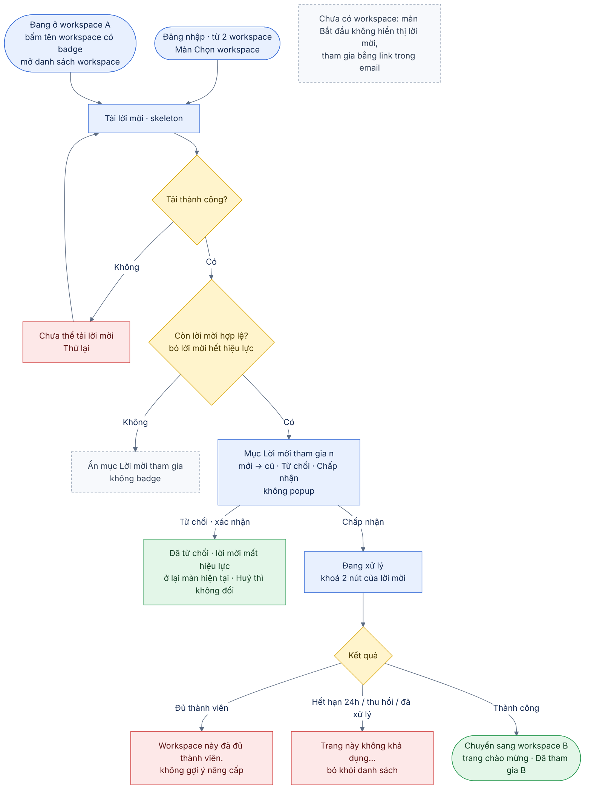
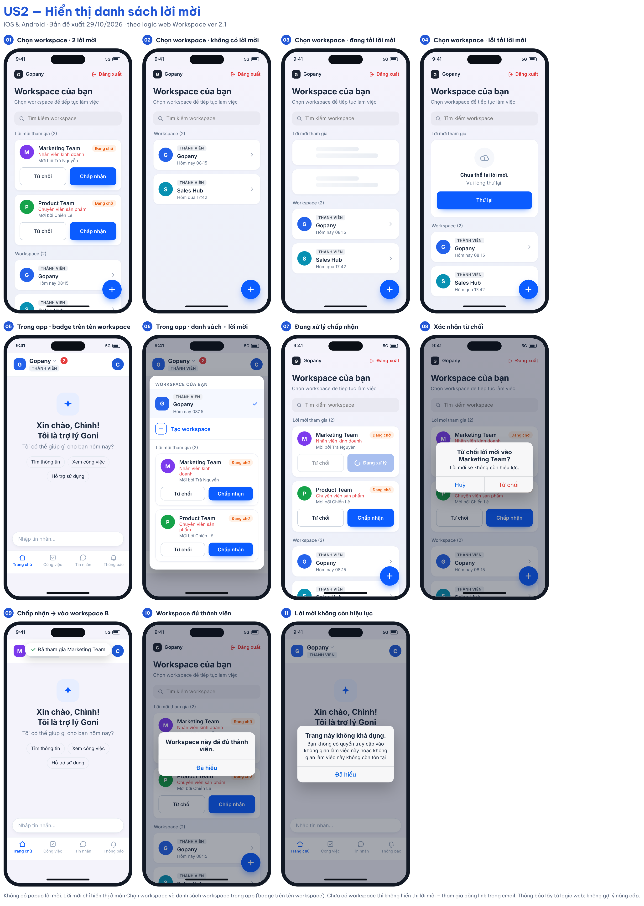

# 02 [EPIC-WS] US2 – Hiển thị danh sách lời mời

> **Tóm tắt:** Lời mời tham gia workspace hiển thị dạng danh sách, không dùng popup, ở 2 vị trí: màn Chọn workspace (đăng nhập có từ 2 workspace) và danh sách workspace trong app (badge trên tên workspace). Mỗi lời mời có Chấp nhận/Từ chối; chấp nhận thì chuyển sang workspace được mời; từ chối thì lời mời mất hiệu lực; đầy đủ loading, rỗng, lỗi · **Nền tảng:** Android, iOS · **Wireframe:** `gopany-wireframe-workspace-mobile.html` (tab Lời mời) · **Số AC:** 17 · **Priority:** High – đề xuất · **Logic web:** US-WS-05, 07B, 10, 12, 13, 15, A7, A26

**Trạng thái:** Draft v1.1 (29/10/2026) – chờ PM review. Thay cho US3 cũ (Xem và xử lý lời mời); US2 cũ (Mời thành viên sau khi tạo) đã bỏ. Đã đối chiếu logic web *Workspace ver 2.1*. Bản sửa trực tiếp: tài liệu "US2 – Hiển thị danh sách lời mời" trên Claude.

## 1. Background

Design cũ có nhắc đến lời mời nhưng thiếu nơi xem rõ ràng. Hệ thống đã có dữ liệu và cơ chế chấp nhận/từ chối lời mời, nên không cần backend mới.

Trên web, người dùng tham gia workspace bằng cách mở email mời và bấm link. Hệ thống chưa có mã tham gia hay link dùng chung. Người chưa có workspace nào vào màn Bắt đầu chỉ thấy thẻ Tạo workspace (US1); họ tham gia bằng link trong email như web.

**Logic web áp dụng cho app (Workspace ver 2.1):**

* Web: đang ở workspace A mà có lời mời vào workspace B → popup xác nhận (A7). **App: không dùng popup** (quyết định 29/10); lời mời nằm trong danh sách kèm badge. Đồng ý → chuyển sang workspace B ở trang chào mừng. Không đồng ý → ở lại, **lời mời không còn hiệu lực** (A7, US-WS-10).
* Web: tải lại trang mà còn lời mời → hiện lại popup (US-WS-12, US-WS-14). **App:** lời mời còn hiệu lực vẫn nằm trong danh sách và badge sau mỗi lần mở/quay lại app; chưa thao tác thì không tự tham gia.
* Nhiều lời mời → sắp xếp **từ mới đến cũ**; lời mời không còn hiệu lực không hiển thị (US-WS-13 áp dụng cho thứ tự).
* Lời mời hiệu lực **24 giờ**. Hết hạn, thu hồi, workspace không tồn tại hoặc đã xử lý → "Trang này không khả dụng. Bạn không có quyền truy cập vào không gian làm việc này hoặc không gian làm việc này không còn tồn tại" (US-WS-12, US-WS-15).
* Web: mở link mời khi đăng nhập sai email → thông báo email A/B (US-WS-11). **App: không có màn này** – danh sách chỉ hiển thị lời mời gửi tới email của tài khoản đang đăng nhập.
* Tham gia thành công → workspace mới xuất hiện ngay trong danh sách; không gửi mật khẩu mới (US-WS-07B, A26).

**Vị trí hiển thị lời mời trên app:**

| Trạng thái người dùng | Cách hiển thị | Ghi chú |
|-----------------------|---------------|---------|
| Đăng nhập có từ 2 workspace (màn Chọn workspace) | Mục **Lời mời tham gia (n)** dưới ô tìm kiếm, trên danh sách workspace | Không có lời mời thì ẩn mục |
| Đang ở trong một workspace (danh sách workspace trong app) | Badge số lời mời trên tên workspace; bấm tên mở danh sách workspace, mục **Lời mời tham gia** với Chấp nhận/Từ chối | Khác web (web dùng popup) – quyết định 29/10 |
| Chưa có workspace (màn Bắt đầu) | Không hiển thị lời mời; tham gia bằng link trong email | Ngoài phạm vi US2 – chờ PM xác nhận (Open Question 1) |

## 2. User Story

Là **người được mời vào workspace**, tôi muốn **thấy danh sách lời mời ngay trong app và chấp nhận hoặc từ chối**, để **tham gia đúng workspace mà không phải mở lại email hay tự tạo workspace mới**.

## 3. Scope

**Trong phạm vi:**

* Danh sách lời mời tại màn Chọn workspace (đăng nhập có từ 2 workspace).
* Danh sách lời mời trong danh sách workspace khi đang ở trong app; badge số lời mời trên tên workspace.
* Thẻ lời mời: workspace, chức vụ được gán, người mời, nhãn Đang chờ, Chấp nhận/Từ chối.
* Chấp nhận/từ chối bằng cơ chế hiện có; chuyển workspace sau khi chấp nhận.
* Thông báo đủ thành viên, lời mời không còn hiệu lực (theo web).
* Loading, lỗi tải, thử lại; tải lại khi quay lại app.

**Ngoài phạm vi:** Hiển thị lời mời khi chưa có workspace (màn Bắt đầu chỉ có Tạo workspace – US1); popup xác nhận lời mời tự bật (web A7/US-WS-12/13/14); tạo/gửi lời mời (màn Nhân sự, SĐCCTC); mã/link tham gia dùng chung; màn tạo mật khẩu và kích hoạt nhanh (US-WS-06, 07A – luồng đăng nhập); thay đổi giới hạn thành viên, gói; chia sẻ Zalo.

## 4. User flow

 

Hai điểm vào (màn Chọn workspace, danh sách workspace trong app) dùng chung một luồng tải và xử lý lời mời; iOS và Android giống nhau về logic.

## 5. Wireframe

 

| Màn/trạng thái | Nội dung |
|----------------|----------|
| Màn Chọn workspace · có lời mời | Thanh trên cùng: logo **Gopany**, **Đăng xuất**. Tiêu đề "Workspace của bạn", ô tìm kiếm; mục **Lời mời tham gia (n)** ngay dưới ô tìm kiếm, tiếp theo là **Workspace (n)**. Chưa có workspace Admin thì có nút **+** nổi (US1). |
| Màn Chọn workspace · không có lời mời | Ẩn mục Lời mời tham gia; chỉ có danh sách workspace. |
| Thẻ lời mời | Avatar tròn, tên workspace, **chức vụ được gán** (chữ đỏ, theo A27), "Mời bởi {người mời}", nhãn **Đang chờ** (cam) góc phải; hai nút **Từ chối** (viền) và **Chấp nhận** (nền xanh). Mới nhất lên đầu. |
| Trong app · badge | Badge đỏ số lời mời cạnh tên workspace trên thanh trên cùng. Không có popup tự bật. |
| Trong app · danh sách workspace | Bấm tên workspace mở danh sách: các workspace, **+ Tạo workspace** (nếu chưa có Admin), mục **Lời mời tham gia (n)** dùng cùng thẻ lời mời. |
| Đang tải | Skeleton 2 dòng tại khu vực lời mời. |
| Lỗi tải | Minh hoạ đám mây; "Chưa thể tải lời mời." – "Vui lòng thử lại." + nút **Thử lại**. Không ẩn mục như khi không có lời mời. |
| Đang xử lý | Nút đã bấm hiện spinner "Đang xử lý", cả hai nút của lời mời đó disable. |
| Từ chối | Hộp xác nhận "Từ chối lời mời vào {tên}?" – "Lời mời sẽ không còn hiệu lực." – **Huỷ** / **Từ chối**. |
| Chấp nhận thành công | Chuyển sang workspace vừa tham gia, mở trang chào mừng (Trợ lý Goni – chờ Q10), thông báo "Đã tham gia {tên}". |
| Đủ thành viên | "Workspace này đã đủ thành viên." – **Đã hiểu**. Không có gợi ý nâng cấp. |
| Không còn hiệu lực | "Trang này không khả dụng. Bạn không có quyền truy cập vào không gian làm việc này hoặc không gian làm việc này không còn tồn tại" – **Đã hiểu**; lời mời bị bỏ khỏi danh sách. |

**Khác biệt nền tảng:** chỉ khác về hình thức – iOS dùng alert giữa màn và toast phía trên; Android dùng dialog Material và snackbar phía dưới.

## 6. Business Rules

| Mã  | Quy tắc |
|-----|---------|
| BR1 | Lời mời chưa xử lý hiển thị dạng danh sách tại 2 vị trí: màn Chọn workspace và danh sách workspace trong app. App không dùng popup tự bật. |
| BR2 | Không có lời mời hợp lệ thì ẩn mục Lời mời tham gia và không hiển thị badge. Màn Bắt đầu (chưa có workspace) không hiển thị lời mời. |
| BR3 | Danh sách chỉ hiển thị lời mời gửi tới email của tài khoản đang đăng nhập; không thêm workspace vào sai tài khoản. App không có màn báo sai tài khoản (US-WS-11 chỉ áp dụng khi mở link mời trên web). |
| BR4 | Mọi vị trí đều hỗ trợ Chấp nhận/Từ chối bằng cơ chế hiện có. Từ chối có bước xác nhận. Chưa xử lý thì không tự động tham gia. |
| BR5 | Tham gia thành công bổ sung workspace vào tài khoản hiện có, không gửi mật khẩu mới; workspace xuất hiện ngay trong danh sách; quyền theo chức vụ được gán (US-WS-07B, A26). |
| BR6 | Chấp nhận thành công ở bất kỳ vị trí nào → cập nhật workspace hiện hành sang workspace vừa tham gia và mở trang chào mừng, thông báo "Đã tham gia {tên}" (A7, US-WS-10). |
| BR7 | Từ chối → người dùng ở lại màn/workspace hiện tại; lời mời không còn hiệu lực. Mở lại link mời đó hiển thị thông báo không khả dụng (A7). |
| BR8 | Nhiều lời mời: sắp xếp từ mới đến cũ; lời mời không còn hiệu lực không hiển thị (US-WS-13). |
| BR9 | Đang ở trong workspace mà có lời mời: badge số lời mời trên tên workspace; mở app/quay lại app thì cập nhật badge và danh sách. Không bật popup. |
| BR10 | Lời mời hiệu lực 24 giờ. Hết hạn, thu hồi, workspace không tồn tại hoặc đã xử lý → không cho tham gia, hiển thị câu thông báo không khả dụng của web (US-WS-15) và bỏ lời mời khỏi danh sách. |
| BR11 | Đang xử lý thì vô hiệu hoá cả hai nút của lời mời tương ứng để tránh gửi lặp. |
| BR12 | Lỗi tải có trạng thái riêng kèm Thử lại, không hiển thị như không có lời mời. Sau lỗi xử lý, cập nhật trạng thái hiện tại trước khi cho thử lại. |
| BR13 | Lời mời đã xử lý không tiếp tục hiển thị như đang chờ ở vị trí khác. Danh sách tải lại khi app quay lại foreground (người dùng vừa bấm link trong email). |
| BR14 | Chưa có workspace Admin thì vẫn có điểm vào Tạo workspace theo US1 tại màn Chọn workspace (nút + nổi) và danh sách workspace (+ Tạo workspace). Không bắt buộc tạo trước khi tham gia. |
| BR15 | Thông báo đủ thành viên/không khả dụng không có gợi ý nâng cấp, gói hay link thanh toán. |

## 7. Acceptance Criteria

*Nội dung thông báo lấy từ logic web khi có; nội dung còn lại là đề xuất, cần duyệt trước nghiệm thu.*

| Mã  | Tình huống | Kết quả mong đợi |
|-----|------------|------------------|
| AC1 | Đăng nhập, có từ 2 workspace và có lời mời chưa xử lý | Màn Chọn workspace có mục "Lời mời tham gia (n)" trên danh sách workspace; mỗi thẻ có Chấp nhận/Từ chối; không bật popup. |
| AC2 | Đăng nhập, có từ 2 workspace, không có lời mời | Không hiển thị mục Lời mời tham gia; chỉ có danh sách workspace. |
| AC3 | Đang ở trong workspace A, có lời mời hợp lệ vào workspace B | Không bật popup; tên workspace có badge số lời mời; bấm tên mở danh sách workspace thấy mục Lời mời tham gia với Chấp nhận/Từ chối. |
| AC4 | Đăng nhập có 1 workspace và có lời mời | Vào thẳng workspace đó; lời mời hiện bằng badge trên tên workspace, không bật popup. |
| AC5 | Có từ 2 lời mời hợp lệ | Danh sách hiển thị đủ các lời mời, mới nhất lên đầu; badge và số (n) đúng số lượng. |
| AC6 | Mở lại app khi vẫn còn lời mời chưa xử lý | Không bật popup; badge và danh sách vẫn hiển thị lời mời còn hiệu lực; không tự tham gia. |
| AC7 | Đang tải dữ liệu lời mời | Skeleton tại khu vực lời mời; chưa kết luận không có lời mời. |
| AC8 | Tải lời mời thất bại | "Chưa thể tải lời mời." và nút Thử lại (đề xuất); không ẩn mục như khi không có lời mời. |
| AC9 | Chấp nhận thành công từ màn Chọn workspace | Vào thẳng workspace vừa tham gia, mở trang chào mừng, thông báo "Đã tham gia {tên}". |
| AC10 | Chấp nhận thành công từ danh sách workspace trong app | Chuyển sang workspace vừa tham gia, mở trang chào mừng (không ở lại workspace cũ); badge giảm tương ứng. |
| AC11 | Bấm Từ chối trong danh sách | Hộp xác nhận "Từ chối lời mời vào {tên}?"; Huỷ thì không đổi; Từ chối thì lời mời biến mất, thông báo "Đã từ chối lời mời". |
| AC12 | Chấp nhận nhưng workspace đã đủ thành viên | Không cho tham gia; "Workspace này đã đủ thành viên." Không có gợi ý nâng cấp. |
| AC13 | Lời mời quá 24 giờ, bị thu hồi, đã xử lý hoặc workspace không tồn tại | Không cho tham gia; "Trang này không khả dụng. Bạn không có quyền truy cập vào không gian làm việc này hoặc không gian làm việc này không còn tồn tại"; lời mời bị bỏ khỏi danh sách. |
| AC14 | Đang xử lý hoặc thao tác gặp lỗi | Nút đã bấm hiện spinner, cả hai nút của lời mời đó disable; lỗi có thông báo; Thử lại không tự chấp nhận hoặc thêm thành viên lặp. |
| AC15 | Đã xử lý lời mời tại một vị trí rồi mở vị trí khác | Lời mời đã xử lý không xuất hiện như đang chờ. |
| AC16 | Người dùng rời app bấm link mời trong email rồi quay lại | App tải lại danh sách và badge; nếu đã tham gia qua link thì workspace mới có trong danh sách, lời mời không còn hiển thị. |
| AC17 | Chưa có workspace Admin, đang xem lời mời | Vẫn thấy điểm vào Tạo workspace theo US1: nút + nổi trên màn Chọn workspace, dòng + Tạo workspace trong danh sách workspace. |

## 8. Open Questions

1. Người chưa có workspace nào nhưng có lời mời: app không hiển thị lời mời (màn Bắt đầu chỉ có Tạo workspace), chỉ tham gia được bằng link trong email – PM xác nhận.
2. Tài khoản đăng ký bằng SĐT chưa có email có nhận được lời mời không? (Q3)
3. Link mời mở trên điện thoại sẽ mở app (deep link) hay web? (Q4)
4. "Trang chào mừng" của web tương ứng màn nào trên app? Đề xuất: Trợ lý Goni. (Q10)
5. App không dùng popup lời mời như web (A7, US-WS-12/13/14), chỉ dùng danh sách + badge – PM xác nhận. (Q11)
6. Màn Chọn workspace: mục Lời mời tham gia đặt trên danh sách workspace (đề xuất, dễ thấy) hay dưới danh sách theo hiện trạng?

## 9. Lịch sử thay đổi

| Ngày | Nội dung thay đổi |
|------|-------------------|
| 29/10/2026 | Draft v1.1: bỏ màn thông báo sai tài khoản nhận lời mời (US-WS-11 chỉ áp dụng khi mở link trên web); sửa BR3, bỏ AC14 cũ, đánh số lại AC (còn 17); cập nhật user flow và wireframe |
| 29/10/2026 | Draft v1: US2 mới thay US3 cũ (Xem và xử lý lời mời); US2 cũ (Mời thành viên sau khi tạo) bỏ. Danh sách lời mời chỉ ở màn Chọn workspace và danh sách workspace trong app; bỏ thẻ Tham gia và màn Lời mời tham gia từ màn Bắt đầu; 18 AC |
