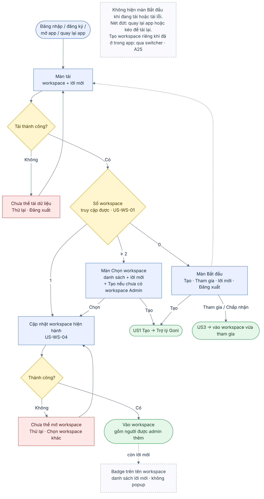
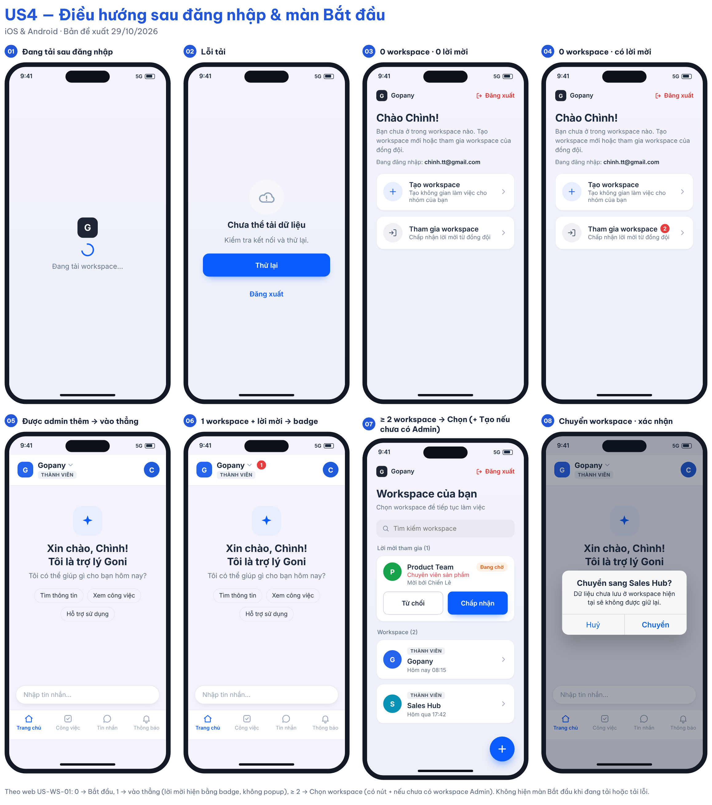

# 04 [EPIC-WS] US4 – Điều hướng sau đăng nhập và màn "Bắt đầu"

> **Tóm tắt:** Sau đăng nhập/đăng ký, app chọn điểm vào theo số workspace truy cập được (như web): 0 → màn Bắt đầu với 2 lựa chọn Tạo / Tham gia; 1 → vào thẳng; ≥ 2 → màn Chọn workspace. Người được admin thêm vào thẳng workspace, không thấy màn trống · **Nền tảng:** Android, iOS · **Wireframe:** `gopany-wireframe-workspace-mobile.html` · **Số AC:** 18 · **Priority:** High – đề xuất · **Logic web:** US-WS-01, 02, 03 (có điều chỉnh), 04, 06, 07A, 09, A24, A25

**Trạng thái:** Draft v1.5 (29/10/2026) – chờ PM review. Đã đối chiếu logic web *Workspace ver 2.1*.

## 1. Background

Màn "Bạn chưa có Workspace nào" hiện là ngõ cụt trên iOS. Ngoài ra, nếu app hiển thị trạng thái trống trước khi tải xong danh sách workspace, người đã được admin thêm vẫn có thể thấy màn trống thoáng qua hoặc bị kẹt khi tải lỗi.

Logic web (US-WS-01): chưa có workspace → màn khởi tạo; có 1 workspace → vào thẳng, không hiển thị màn chọn (A24); có từ 2 workspace → màn chọn workspace, màn này không xử lý tạo workspace (US-WS-03). Mọi nhánh vào workspace đều cập nhật workspace hiện hành trước khi mở màn làm việc; lỗi thì cho thử lại hoặc chọn workspace khác (US-WS-04).

US này gom quy tắc điều hướng về một chỗ và thay màn trống bằng màn **Bắt đầu** có hai lựa chọn rõ ràng.

## 2. User Story

Là **người vừa đăng nhập/đăng ký**, tôi muốn **được đưa thẳng vào workspace của mình, hoặc nếu chưa có thì thấy ngay cách tạo hoặc tham gia**, để **không bao giờ bị kẹt ở màn không có lối đi tiếp**.

## 3. Scope

**Trong phạm vi:** Màn tải sau đăng nhập; quy tắc điểm vào theo số workspace; màn Bắt đầu; màn Chọn workspace (≥ 2 workspace); cập nhật workspace hiện hành và lỗi mở workspace; xác nhận khi chuyển workspace từ switcher; đăng xuất từ màn Bắt đầu; tải lại khi quay lại app; xử lý mất workspace cuối cùng khi mở app.

**Ngoài phạm vi:** Nội dung luồng tạo (US1), mời (US2), xử lý lời mời (US3); màn tạo mật khẩu, kích hoạt nhanh (US-WS-06, 07A – luồng đăng nhập); khoá tài khoản/nghỉ việc; đăng nhập/đăng ký (Epic SĐT/OTP).

## 4. User flow

 

## 5. Wireframe

 

**Bảng điểm vào sau đăng nhập/đăng ký/mở app**

| # | Workspace truy cập được | Lời mời đang chờ | Điểm vào | Logic web |
|---|-------------------------|------------------|----------|-----------|
| 1 | Đang tải | – | Màn tải (logo + spinner) | – |
| 2 | Lỗi tải | – | Màn lỗi "Chưa thể tải dữ liệu" + Thử lại + Đăng xuất | US-WS-01 |
| 3 | 0 | 0 | Màn Bắt đầu: Tạo / Tham gia | US-WS-02 |
| 4 | 0 | ≥ 1 | Màn Bắt đầu: Tạo / Tham gia (badge số lời mời); danh sách nằm trong màn Tham gia workspace | US-WS-02, US3 |
| 5 | 1 | 0 | Vào thẳng workspace đó (gồm người được admin thêm/kích hoạt nhanh) | US-WS-01, A24, US-WS-07A |
| 6 | 1 | ≥ 1 | Vào thẳng workspace; badge số lời mời trên tên workspace, danh sách trong màn danh sách workspace (US3). Không bật popup | A24; khác A7/US-WS-12 (không popup) |
| 7 | ≥ 2 | bất kỳ | Màn Chọn workspace: danh sách workspace + lời mời; **+ Tạo workspace** nếu chưa có workspace Admin | US-WS-01; khác US-WS-03 (quyết định PM) |
| 8 | Vừa tham gia qua link mời/tạo mật khẩu | – | Vào thẳng workspace được mời | US-WS-06, 07A |

| Màn/trạng thái | Nội dung |
|----------------|----------|
| Màn Bắt đầu | Thanh trên cùng: logo **Gopany** bên trái, **Đăng xuất** (chữ đỏ, có icon) bên phải. Lời chào "Chào {tên}!"; "Bạn chưa ở trong workspace nào. Tạo workspace mới hoặc tham gia workspace của đồng đội."; dòng "Đang đăng nhập: {email/SĐT}"; thẻ **Tạo workspace**; thẻ **Tham gia workspace** (badge số lời mời, bấm vào mở màn Lời mời tham gia – US3). Không hiển thị danh sách lời mời. Không có gói, giá hay nâng cấp. |
| Màn Chọn workspace | Thanh trên cùng: logo **Gopany** bên trái, **Đăng xuất** (chữ đỏ, có icon) bên phải. Tiêu đề "Workspace của bạn", mô tả "Chọn workspace để tiếp tục làm việc"; ô **Tìm kiếm workspace**; mục "Lời mời tham gia" (chỉ hiện khi có lời mời) với thẻ lời mời; mỗi workspace là một thẻ: nhãn vai trò (Quản trị viên/Thành viên), tên, lần truy cập gần nhất ("Hôm nay 08:15" hoặc "Chưa truy cập lần nào"), mũi tên; nút **+** nổi góc dưới phải nếu chưa có workspace Admin (US1 TH3). |
| Màn lỗi tải | Icon mây; "Chưa thể tải dữ liệu. Kiểm tra kết nối và thử lại."; **Thử lại**; liên kết **Đăng xuất**. |
| Lỗi mở workspace | "Chưa thể mở workspace. Vui lòng thử lại."; **Thử lại**; **Chọn workspace khác** nếu còn workspace khác (US-WS-04). |
| Xác nhận chuyển workspace | Chọn workspace khác trong switcher → hộp "Chuyển sang {tên}?" – "Dữ liệu chưa lưu ở workspace hiện tại sẽ không được giữ lại." – Huỷ / Chuyển (US-WS-09). |

## 6. Business Rules

| Mã  | Quy tắc |
|-----|---------|
| BR1 | Điểm vào chỉ được quyết định sau khi tải thành công danh sách workspace truy cập được và lời mời đang chờ. Trong lúc tải hiển thị màn tải. |
| BR2 | Lỗi tải hiển thị màn lỗi có Thử lại; không chuyển sang màn Bắt đầu. |
| BR3 | "Workspace truy cập được" không gồm workspace mà tài khoản bị khoá hoặc đã chuyển Nghỉ việc. |
| BR4 | 0 workspace truy cập được → màn Bắt đầu, có hoặc không có lời mời (US-WS-02). |
| BR5 | Người được admin thêm trực tiếp (thêm nhân sự, kích hoạt nhanh) đã có workspace truy cập được nên áp dụng BR6/BR7, không bao giờ thấy màn Bắt đầu. |
| BR6 | 1 workspace truy cập được → vào thẳng, không hiển thị màn chọn (A24). Lời mời đang chờ hiển thị bằng badge trên tên workspace và danh sách trong màn danh sách workspace (US3); không bật popup. |
| BR7 | ≥ 2 workspace truy cập được → màn Chọn workspace (US-WS-01). Nếu chưa có workspace nào mang vai trò Admin, màn này có + Tạo workspace (US1 BR1). Khác web US-WS-03, theo quyết định PM 29/10. |
| BR8 | Mọi nhánh vào workspace đều cập nhật workspace hiện hành trước khi mở màn làm việc. Lỗi → thông báo, cho Thử lại hoặc Chọn workspace khác (US-WS-04). |
| BR9 | Thẻ Tạo workspace trên màn Bắt đầu theo điều kiện US1 BR1. Thẻ Tham gia luôn hiển thị. |
| BR10 | Màn Bắt đầu luôn có thông tin tài khoản đang đăng nhập và Đăng xuất để người dùng đổi tài khoản nếu được mời bằng email khác. |
| BR11 | Khi app quay lại foreground ở màn Bắt đầu, tải lại danh sách; nếu đã có workspace (vừa tham gia qua link hoặc vừa được admin thêm) thì điều hướng lại theo bảng điểm vào. |
| BR12 | Mở app khi workspace hiện hành không còn truy cập được: áp dụng lại bảng điểm vào với danh sách mới (còn 1 → vào thẳng; còn ≥ 2 → màn Chọn; còn 0 → màn Bắt đầu). |
| BR13 | Chuyển workspace từ switcher: hiển thị cảnh báo dữ liệu chưa lưu để người dùng xác nhận; lỗi tải danh sách hoặc workspace không còn quyền truy cập → báo lỗi và giữ workspace hiện tại (US-WS-09). |
| BR14 | Không có màn nào trong luồng hiển thị gói, giá, nút nâng cấp hay link thanh toán trên iOS. |

## 7. Acceptance Criteria

| Mã  | Tình huống | Kết quả mong đợi |
|-----|------------|------------------|
| AC1 | Đăng nhập thành công, dữ liệu đang tải | Hiển thị màn tải; không hiện màn Bắt đầu thoáng qua. |
| AC2 | Tải dữ liệu thất bại | Màn lỗi có Thử lại và Đăng xuất; Thử lại thành công thì điều hướng theo bảng điểm vào. |
| AC3 | 0 workspace, 0 lời mời | Màn Bắt đầu với thẻ Tạo (nếu đủ điều kiện) và Tham gia; bấm Tham gia thấy hướng dẫn mở link trong email (US3 AC3). |
| AC4 | 0 workspace, có lời mời | Màn Bắt đầu; thẻ Tham gia có badge số lời mời; danh sách chỉ hiển thị khi bấm Tham gia (US3 AC2). |
| AC5 | Được admin thêm vào 1 workspace, không có lời mời | Vào thẳng workspace; không thấy màn Bắt đầu hay màn Chọn. |
| AC6 | Có 1 workspace và có lời mời mới | Vào thẳng workspace; không bật popup; tên workspace có badge số lời mời (US3 AC4). |
| AC7 | Có ≥ 2 workspace | Màn Chọn workspace; chọn một workspace thì vào workspace đó. |
| AC8 | Màn Chọn workspace | Có + Tạo workspace khi tất cả workspace đều vai trò Thành viên; không có khi đã có workspace Admin. |
| AC9 | Cập nhật workspace hiện hành thất bại khi vào workspace | Thông báo lỗi; Thử lại; Chọn workspace khác nếu còn workspace khác. |
| AC10 | Người dùng iOS chưa có workspace | Không còn bị kẹt: màn Bắt đầu có lựa chọn Tạo (nếu đủ điều kiện) và Tham gia. |
| AC11 | Ở màn Bắt đầu, bấm Đăng xuất | Đăng xuất về màn đăng nhập. |
| AC12 | Ở màn Bắt đầu, rời app bấm link mời trong email, tham gia xong quay lại app | App tải lại và vào thẳng workspace vừa tham gia. |
| AC13 | Ở màn Bắt đầu, trong lúc đó admin thêm người dùng vào workspace | Lần tải lại kế tiếp (quay lại app hoặc kéo để tải lại) điều hướng vào workspace đó. |
| AC14 | Mở app khi bị xoá khỏi workspace cuối cùng | Màn Bắt đầu, có Tạo nếu đủ điều kiện. |
| AC15 | Chọn workspace khác trong switcher | Hộp xác nhận cảnh báo dữ liệu chưa lưu; Huỷ thì ở lại; Chuyển thì vào workspace đã chọn. Lỗi thì giữ workspace hiện tại. |
| AC16 | Rà các màn của US4 trên iOS | Không có gói, giá, nâng cấp, link thanh toán. |
| AC17 | Gõ vào ô Tìm kiếm workspace | Danh sách lọc theo tên, không phân biệt hoa/thường; không có kết quả thì hiện "Không tìm thấy workspace phù hợp." |
| AC18 | Thẻ workspace chưa từng mở | Dòng phụ hiện "Chưa truy cập lần nào" thay cho thời gian truy cập gần nhất. |

## 8. Open Questions

1. API sau đăng nhập trả workspace và lời mời trong một lần hay hai lần gọi? Nếu hai, lỗi một phần (tải được workspace, lỗi lời mời) có điều hướng theo workspace và chỉ báo lỗi ở khu vực lời mời không? (Đề xuất: có.)
2. Màn Bắt đầu có hỗ trợ kéo để tải lại không? (Đề xuất: có.)
3. Cảnh báo dữ liệu chưa lưu khi chuyển workspace: luôn hiện hay chỉ hiện khi có dữ liệu đang nhập dở?
4. Hệ thống đã lưu thời gian truy cập gần nhất của từng workspace chưa? Nếu chưa, thẻ workspace bỏ dòng này hoặc thay bằng số thành viên.

*Đã chốt: Q1 (1 workspace + lời mời → vào thẳng, lời mời hiện bằng badge – không dùng popup của web, quyết định 29/10), Q2 (≥ 2 workspace → màn Chọn).*

## 9. Lịch sử thay đổi

| Ngày | Nội dung thay đổi |
|------|-------------------|
| 29/10/2026 | Draft v1 theo hướng mới của PM |
| 29/10/2026 | Draft v1.1: đối chiếu logic web – chốt Q1, Q2; bỏ Tạo ở màn Chọn workspace (US-WS-03); thêm lỗi mở workspace có Chọn workspace khác (US-WS-04); xác nhận khi chuyển workspace (US-WS-09); thêm cột logic web vào bảng điểm vào |
| 29/10/2026 | Draft v1.2: màn Chọn workspace có + Tạo workspace khi chưa có workspace Admin (quyết định PM, khác web US-WS-03) |
| 29/10/2026 | Draft v1.3: màn Bắt đầu không còn danh sách lời mời; danh sách nằm trong màn Tham gia workspace (US3) |
| 29/10/2026 | Draft v1.4: làm lại wireframe theo design tham khảo – thanh logo + Đăng xuất; màn Chọn workspace có ô tìm kiếm, thẻ workspace kèm lần truy cập gần nhất, nút + nổi; thêm AC17, AC18 |
| 29/10/2026 | Draft v1.5: bỏ popup lời mời khi vào thẳng workspace; dùng badge + danh sách (US3) |
