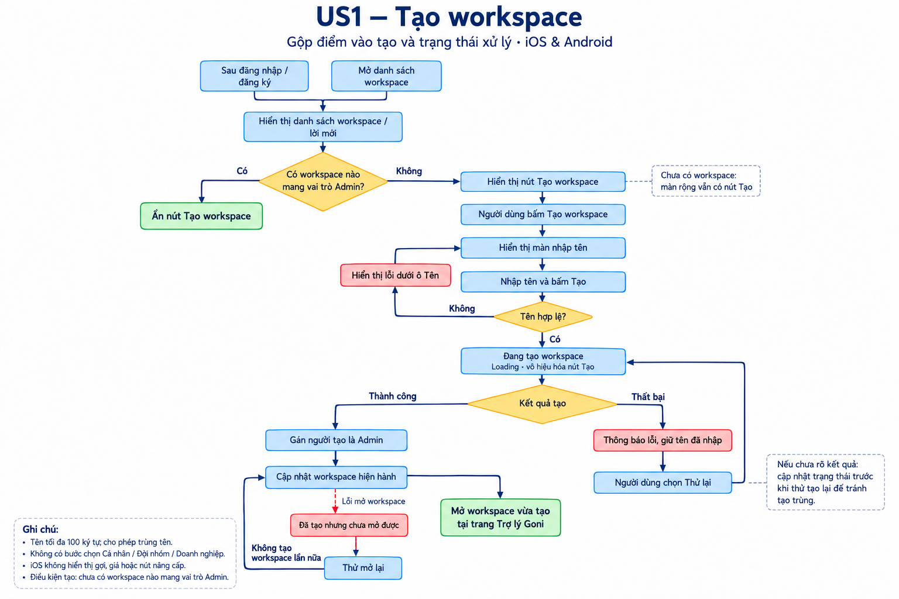
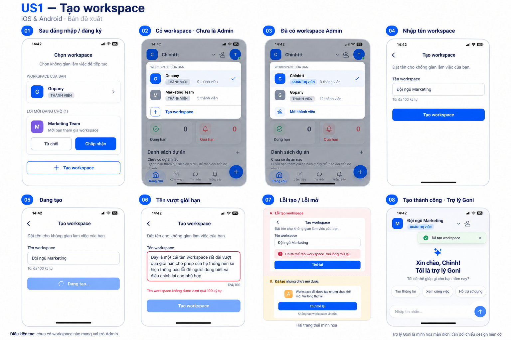

# 01 [EPIC-WS] US1 – Tạo workspace

> **Tóm tắt:** Mở lại tạo trên iOS, cập nhật Android; hiển thị điểm vào theo vai trò Admin, nhập tên, tạo và mở Trợ lý Goni; đầy đủ trạng thái xử lý · **Nền tảng:** Android, iOS · **Wireframe:** Chờ Design · **Số AC:** 14 · **Priority:** High – đề xuất

## 1. Background

iOS đang ẩn tạo workspace sau lần Apple reject theo phản ánh PM, khiến người chưa có workspace bị kẹt tại màn "Bạn chưa có Workspace nào". Android có luồng theo design cũ. Màn danh sách thiếu nút tạo mới; thiếu loading/lỗi. Bước Cá nhân/Đội nhóm/Doanh nghiệp nhìn giống chọn gói.

Anh Chiến xác nhận bỏ bước chọn mô hình không ảnh hưởng logic hoặc workspace hiện có. Quyền lợi theo gói dịch vụ. Theo cập nhật của Chình dựa trên thông tin chị Trà cung cấp, điều kiện tạo được xác định bằng việc tài khoản có workspace mang vai trò Admin hay chưa, vì hiện chưa có cơ chế gán quyền.

## 2. User Story

Là **người dùng chưa có workspace nào mang vai trò Admin**, tôi muốn **thấy nút tạo và tạo workspace bằng cách nhập tên**, để **có workspace do mình quản trị và bắt đầu làm việc tại Trợ lý Goni**.

## 3. Scope

**Trong phạm vi:** Điểm vào tạo tại màn sau đăng nhập/đăng ký, màn chưa có workspace và danh sách workspace; kiểm tra vai trò Admin; mở lại tạo iOS, cập nhật Android; bỏ chọn mô hình; nhập tên, tạo/gán Admin, cập nhật workspace hiện hành và mở Trợ lý Goni; loading, rỗng, validation, lỗi và thử lại.

**Ngoài phạm vi:** Thay đổi gói/giới hạn thành viên; mời thành viên sau tạo; chia sẻ Zalo; xây dựng cơ chế gán quyền hoặc thiết kế lại chuyển workspace. Xem và xử lý lời mời thuộc US3. Đề xuất cho tạo nhiều workspace quản trị chưa được đưa vào rule này.

## 4. User flow

 

## 5. Wireframe

 

## 6. Business Rules

| Mã  | Quy tắc |
|-----|---------|
| BR1 | Tài khoản chưa có workspace nào mang vai trò Admin thì được tạo; đã có ít nhất một workspace mang vai trò Admin thì không được tạo thêm theo phạm vi hiện tại. |
| BR2 | Có workspace với vai trò thành viên hoặc có lời mời chưa xử lý không làm mất điều kiện tạo nếu vẫn đáp ứng BR1. Không tự dùng lịch sử tạo hoặc người tạo ban đầu làm tiêu chí khác. |
| BR3 | Nút Tạo workspace hiển thị theo BR1 tại các màn trong scope. Nếu không có workspace, có trạng thái rỗng và điểm vào tạo. |
| BR4 | Tên tối đa 100 ký tự; cho phép trùng; cho phép tiếng Việt có/không dấu, hoa/thường, số, khoảng trắng, ký tự đặc biệt và emoji theo xác nhận trước. Validation còn thiếu xem mục 8. |
| BR5 | Bỏ bước Cá nhân/Đội nhóm/Doanh nghiệp; không thay đổi gói dịch vụ khi bỏ bước chọn. |
| BR6 | Tạo thành công thì người tạo được gán Admin trong workspace vừa tạo; quyền độc lập giữa các workspace. |
| BR7 | Trong lúc gửi tạo, hiển thị đang xử lý và disable nút Tạo. Phía hệ thống kiểm soát điều kiện để yêu cầu lặp không tạo thêm workspace trái BR1. |
| BR8 | Tạo thành công cập nhật danh sách và workspace hiện hành rồi mở trang Trợ lý Goni. |
| BR9 | Lỗi tải có Thử lại; chỉ hiển thị rỗng sau khi tải thành công. Lỗi tạo giữ tên để sửa/thử lại. |
| BR10 | Khi chưa xác định kết quả tạo, cập nhật trạng thái trước khi thử gửi lại. Đã tạo nhưng chưa mở được thì chỉ thử mở, không tạo lại. |
| BR11 | Validation hiển thị tại trường tên; lỗi tải/tạo/mở hiển thị theo đúng ngữ cảnh. Không bổ sung hạn mức thử lại hoặc đếm ngược mới. |

## 7. Acceptance Criteria

*AC liên quan validation còn thiếu và nội dung đề xuất chỉ chốt nghiệm thu sau khi được duyệt.*

| Mã  | Tình huống | Kết quả mong đợi |
|-----|------------|------------------|
| AC1 | Tài khoản chưa có workspace nào mang vai trò Admin | Hiển thị Tạo workspace tại các màn trong scope, kể cả đang tham gia workspace khác hoặc có lời mời. |
| AC2 | Tài khoản có ít nhất một workspace mang vai trò Admin | Không hiển thị nút tạo thêm; kiểm tra lại điều kiện phía hệ thống nếu có yêu cầu tạo. |
| AC3 | Tải thành công, tài khoản chưa có workspace | Hiển thị màn rỗng "Bạn chưa có workspace nào" và nút Tạo workspace. |
| AC4 | Đang tải dữ liệu danh sách | Hiển thị loading; chưa kết luận rỗng hoặc quyền tạo trước kết quả. Không cần thêm màn "tải điều kiện" riêng. |
| AC5 | Tải danh sách thất bại | Thông báo lỗi, có Thử lại; không thay bằng trạng thái chưa có workspace. |
| AC6 | Người đủ điều kiện bấm Tạo workspace | Mở màn nhập tên trên iOS/Android; không qua chọn mô hình. |
| AC7 | Nhập tên hợp lệ và bấm Tạo | Thực hiện tạo; loading và disable nút để tránh gửi lặp. |
| AC8 | Tên vượt 100 ký tự theo cách đếm được chốt | Không tạo; báo "Tên workspace không được vượt quá 100 ký tự" dưới ô tên. |
| AC9 | Tên trùng workspace khác nhưng đáp ứng các điều kiện khác | Không từ chối chỉ vì trùng tên. |
| AC10 | Tạo thành công | Gán người tạo là Admin, cập nhật danh sách và workspace hiện hành; mở trang Trợ lý Goni của workspace vừa tạo. |
| AC11 | Tạo thất bại | Thông báo lỗi, giữ tên; cho phép thao tác tiếp theo theo trạng thái thực tế. Đề xuất: "Chưa thể tạo workspace. Vui lòng thử lại." |
| AC12 | Timeout chưa rõ tạo thành công hay chưa | Kiểm tra kết quả hiện tại; nếu đã tạo thì tiếp tục mở, chưa tạo thì cho thử lại, không tạo trùng. |
| AC13 | Đã tạo nhưng cập nhật/mở workspace lỗi | Đề xuất: "Workspace đã được tạo nhưng chưa thể mở. Vui lòng thử lại." Cho Thử mở lại, không gọi tạo lần nữa. |
| AC14 | Validation tên khác hoặc người dùng bấm lặp | Lỗi đúng trường, giữ tên để sửa; không gửi lặp từ nút khi đang xử lý. Yêu cầu đồng thời không tạo workspace trái điều kiện. |

## 8. Open Questions

1. Tên bắt buộc hay không, độ dài tối thiểu, tên chỉ khoảng trắng và cách trim đầu/cuối?
2. Emoji/ký tự ghép được đếm thế nào trong giới hạn 100?
3. Có cần xác thực email/SĐT trước khi tạo?
4. Phía hệ thống nhận diện vai trò Admin và kiểm soát tạo lặp theo điều kiện mới như thế nào?
5. Khi không còn workspace được phép truy cập nhưng dữ liệu vẫn còn vai trò Admin ở workspace bị chặn, tài khoản có được tạo không? Chỉ chốt điều hướng/điều kiện tạo trong scope.
6. Nội dung/kiểu thông báo và design của từng trạng thái đã được duyệt chưa?
7. PM xác nhận phạm vi bỏ chọn mô hình và ràng buộc iOS; cung cấp phản hồi Apple gốc.

## 9. Lịch sử thay đổi

| Ngày | Nội dung thay đổi |
|------|-------------------|
|      |                   |
|      |                   |

---

#