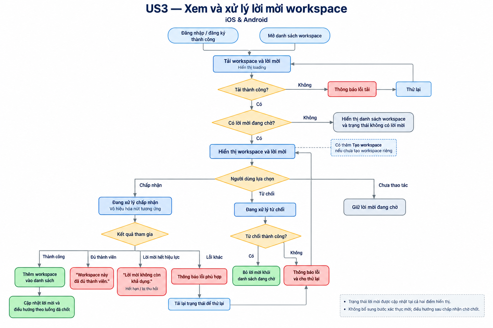
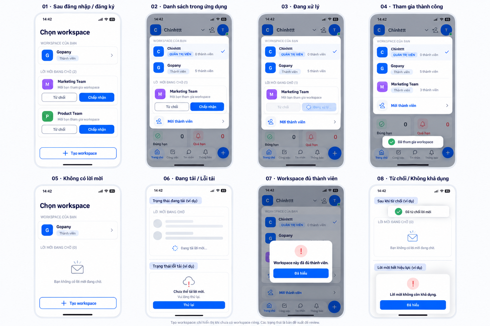

# 03 [EPIC-WS] US3 – Xem và xử lý lời mời workspace

> **Tóm tắt:** Hiển thị và xử lý lời mời tại màn sau đăng nhập/đăng ký thành công và màn danh sách workspace; đầy đủ loading, rỗng, lỗi và thử lại · **Nền tảng:** Android, iOS · **Wireframe:** Chờ Design · **Số AC:** 14 · **Priority:** Chờ PM xác nhận

**Trạng thái:** Draft – chờ review.

## 1. Background

Design cũ có nhắc đến lời mời nhưng thiếu nơi xem rõ ràng. Hệ thống đã có dữ liệu và cơ chế chấp nhận/từ chối lời mời.

Danh sách lời mời cần hiển thị tại hai vị trí:

* Màn sau đăng nhập/đăng ký thành công.
* Màn danh sách workspace.

Người chưa có workspace vẫn phải xem và xử lý được lời mời. Các màn cần đầy đủ trạng thái loading, rỗng, lỗi và thử lại.

## 2. User Story

Là **người có lời mời chưa xử lý**, tôi muốn **xem và chấp nhận hoặc từ chối lời mời tại màn sau đăng nhập/đăng ký thành công và màn danh sách workspace**, để **quyết định tham gia workspace phù hợp**.

## 3. Scope

**Trong phạm vi:** Hiển thị lời mời tại hai vị trí nêu trên; chấp nhận/từ chối bằng cơ chế hiện có; cập nhật kết quả giữa hai vị trí; loading, rỗng, lỗi và thử lại; thông báo khi không thể tham gia.

**Ngoài phạm vi:** Tạo/gửi lời mời; mời thành viên sau tạo workspace; thay đổi giới hạn thành viên, chính sách gói hoặc cơ chế giữ chỗ; chia sẻ Zalo; bổ sung phương thức xác thực mới.

## 4. User flow

 

## 5. Wireframe

 

| Màn/trạng thái | Nội dung |
|----------------|----------|
| Sau đăng nhập/đăng ký thành công | Hiển thị danh sách lời mời chưa xử lý, thao tác Chấp nhận/Từ chối; thêm nút Tạo workspace nếu chưa tạo workspace riêng. |
| Danh sách workspace | Hiển thị các workspace được truy cập và danh sách lời mời chưa xử lý; thêm nút Tạo workspace theo US2. |
| Chưa có workspace, có lời mời | Vẫn xem và xử lý lời mời; không bắt buộc tạo workspace trước. |
| Loading        | Loading khi tải; trạng thái xử lý tại từng lời mời. |
| Rỗng           | Không có lời mời đang chờ tại khu vực lời mời. |
| Lỗi tải        | Thông báo và nút Thử lại. |
| Lỗi xử lý      | Thông báo phù hợp, gồm trường hợp workspace đã đủ thành viên. |

**Yêu cầu thiết kế:** Trên iOS không có giá, nút Nâng cấp, link thanh toán hoặc hướng dẫn lên web nâng cấp theo yêu cầu PM.

## 6. Business Rules

| Mã  | Quy tắc |
|-----|---------|
| BR1 | Danh sách lời mời chưa xử lý được hiển thị tại cả màn sau đăng nhập/đăng ký thành công và màn danh sách workspace. |
| BR2 | Lời mời tương ứng tài khoản nhận; không thêm workspace vào sai tài khoản. |
| BR3 | Hai vị trí hiển thị hỗ trợ Chấp nhận/Từ chối bằng cơ chế hiện có. |
| BR4 | Chưa xử lý lời mời thì không tự động tham gia workspace. |
| BR5 | Tham gia thành công bổ sung workspace vào tài khoản hiện có; quyền theo chức vụ được gán. |
| BR6 | Chưa tạo workspace riêng thì có nút Tạo workspace theo US2, kể cả khi có lời mời hoặc đã tham gia workspace khác. |
| BR7 | Đang xử lý thì vô hiệu hoá thao tác tại lời mời tương ứng để tránh gửi lặp. |
| BR8 | Chỉ hiển thị rỗng khi tải thành công và không có lời mời; lỗi tải có trạng thái riêng. |
| BR9 | Lời mời đã xử lý không được tiếp tục hiển thị như đang chờ tại vị trí còn lại khi tải/cập nhật dữ liệu. |
| BR10 | Lỗi tải có Thử lại; sau lỗi xử lý, cập nhật trạng thái hiện tại trước khi cho thử lại để tránh xử lý lặp. |

## 7. Acceptance Criteria

*Các nội dung thông báo mang nhãn đề xuất và luồng điều hướng chưa chốt cần được duyệt trước nghiệm thu.*

| Mã  | Tình huống | Kết quả mong đợi |
|-----|------------|------------------|
| AC1 | Đăng nhập/đăng ký thành công và có lời mời chưa xử lý | Màn sau đăng nhập/đăng ký hiển thị danh sách lời mời và thao tác Chấp nhận/Từ chối. |
| AC2 | Mở màn danh sách workspace và có lời mời chưa xử lý | Hiển thị lời mời cùng các workspace được phép truy cập, có thao tác Chấp nhận/Từ chối. |
| AC3 | Chưa có workspace nhưng có lời mời | Vẫn xem và xử lý được lời mời tại hai vị trí tương ứng; không yêu cầu tạo workspace trước. |
| AC4 | Chưa tạo workspace riêng | Hiển thị thêm nút Tạo workspace theo US2 tại các màn trong phạm vi. |
| AC5 | Đang tải dữ liệu | Hiển thị loading; chưa kết luận không có lời mời. |
| AC6 | Tải thành công, không có lời mời | Khu vực lời mời hiển thị "Bạn không có lời mời đang chờ." — nội dung đề xuất; không chặn truy cập workspace hiện có. |
| AC7 | Tải lời mời thất bại | Hiển thị "Chưa thể tải lời mời. Vui lòng thử lại." và nút Thử lại — nội dung đề xuất; không dùng trạng thái rỗng thay lỗi. |
| AC8 | Chấp nhận lời mời thành công | Workspace được bổ sung vào danh sách; người dùng nhận quyền theo chức vụ; điều hướng theo luồng được chốt. |
| AC9 | Từ chối lời mời thành công | Không thêm người dùng vào workspace; lời mời không còn ở trạng thái đang chờ. |
| AC10 | Chấp nhận lời mời nhưng workspace đã đủ số thành viên theo gói | Không cho tham gia; hiển thị **"Workspace này đã đủ thành viên."** |
| AC11 | Lời mời hết hạn, bị thu hồi hoặc không còn khả dụng | Không cho tham gia; thông báo lời mời không còn khả dụng và cập nhật danh sách. |
| AC12 | Tài khoản đang đăng nhập không khớp tài khoản nhận lời mời | Không cho tham gia bằng tài khoản sai; thông báo và hướng dẫn dùng đúng tài khoản theo cơ chế hiện có. |
| AC13 | Đang xử lý hoặc thao tác gặp lỗi | Trong lúc xử lý vô hiệu hoá nút tương ứng; lỗi có thông báo phù hợp. Thử lại không tự chấp nhận hoặc thêm thành viên lặp. |
| AC14 | Đã xử lý lời mời tại một vị trí rồi mở vị trí còn lại | Hiển thị trạng thái cập nhật; lời mời đã xử lý không xuất hiện như đang chờ. Nếu chấp nhận thành công, workspace có trong danh sách được truy cập. |

## 8. Open Questions

9\. Lịch sử thay đổi

| Ngày | Nội dung thay đổi |
|------|-------------------|
|      |                   |
|      |                   |