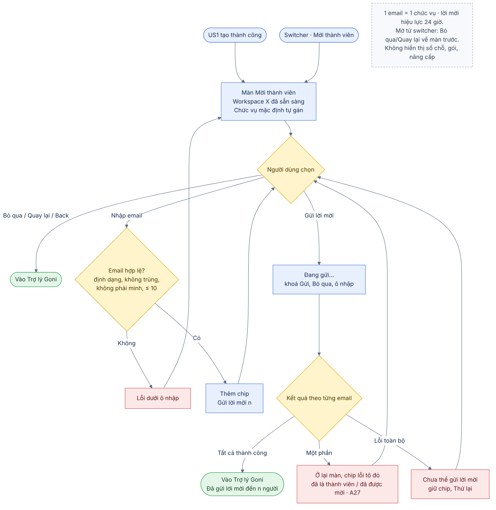
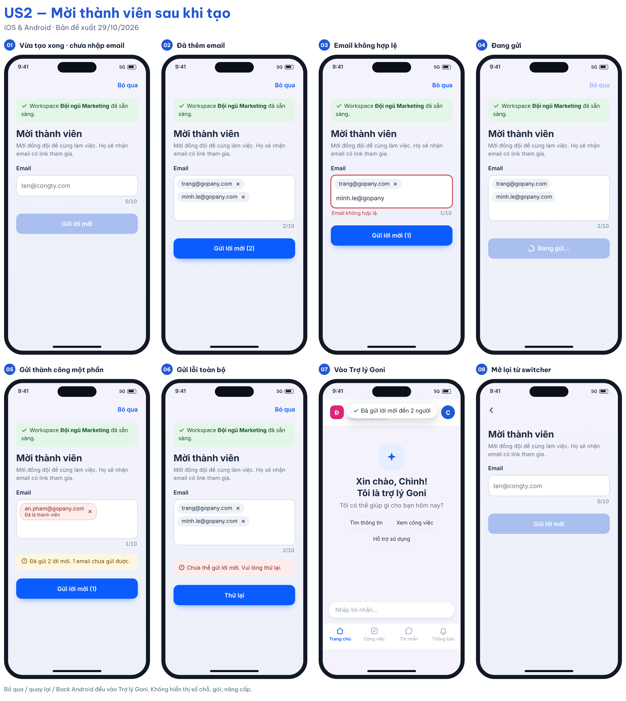

# 02 [EPIC-WS] US2 – Mời thành viên sau khi tạo workspace

> **Tóm tắt:** Ngay sau khi tạo workspace, Admin được gợi ý mời đồng đội qua email; có thể bỏ qua; gửi xong hoặc bỏ qua đều vào thẳng Trợ lý Goni · **Nền tảng:** Android, iOS · **Wireframe:** `gopany-wireframe-workspace-mobile.html` · **Số AC:** 16 · **Priority:** High – đề xuất · **Logic web:** A27, US-WS-05/06/07

**Trạng thái:** **TẠM DỪNG** (29/10/2026) – bước mời thành viên đã bỏ khỏi luồng tạo workspace; tạo xong vào thẳng Trợ lý Goni (US1 v2.7). Nội dung dưới đây là bản Draft v1.2, giữ lại để tham khảo nếu sau này làm lại.

## 1. Background

Theo hướng PM: tạo workspace xong thì mời thành viên (bỏ qua được) rồi vào thẳng app. Một workspace chỉ có mình người tạo thì chưa dùng được các tính năng làm việc nhóm, nên đây là thời điểm hợp lý nhất để mời.

Hiện trạng: hệ thống đã có mời qua email, email có link để chấp nhận; nơi mời hiện có là màn Nhân sự và Sơ đồ tổ chức; quyền thực hiện là "Tạo nhân sự". Người tạo workspace là Admin nên có quyền này. Workspace đã đủ thành viên vẫn mời được; khi người nhận chấp nhận mới hiện thông báo đủ thành viên (theo hiện trạng hệ thống).

Theo logic web (A27): người dùng có thể mời đồng thời từ DSNS và SĐCCTC, hệ thống check trùng email đã mời; **một email mời chỉ được gán 1 chức vụ**. Lời mời có hiệu lực 24 giờ. Người nhận tham gia theo US-WS-05/06/07 (link mời, tạo mật khẩu hoặc kích hoạt nhanh).

US này **dùng lại cơ chế mời qua email đã có**, chỉ thêm một màn mời rút gọn ngay sau bước tạo.

## 2. User Story

Là **Admin vừa tạo workspace**, tôi muốn **mời đồng đội bằng email ngay sau khi tạo, hoặc bỏ qua để làm sau**, để **bắt đầu làm việc cùng nhóm sớm mà không bị chặn lại**.

## 3. Scope

**Trong phạm vi:**

* Màn Mời thành viên hiển thị ngay sau US1 tạo thành công.
* Nhập nhiều email; kiểm tra định dạng, trùng lặp, email của chính mình, email đã được mời từ nguồn khác.
* Gán chức vụ mặc định cho mỗi email mời (A27); không hiển thị chọn chức vụ trên màn.
* Gửi lời mời bằng cơ chế mời hiện có; xử lý thành công một phần.
* Bỏ qua; điều hướng vào Trợ lý Goni.
* Loading, lỗi và thử lại.
* Điểm vào "Mời thành viên" trên switcher cho Admin dùng lại sau này (mở cùng màn này).

**Ngoài phạm vi:** Mời bằng SĐT (chờ Q5); chia sẻ link/Zalo; gán chức vụ khác nhau cho từng email trong cùng lượt (làm ở màn Nhân sự/SĐCCTC); kích hoạt nhanh; thay đổi giới hạn thành viên, gói; thay đổi nội dung email mời.

## 4. User flow

 

## 5. Wireframe

 

| Màn/trạng thái | Nội dung |
|----------------|----------|
| Màn Mời thành viên | Tiêu đề "Mời thành viên"; nút **Bỏ qua** ở góc phải thanh tiêu đề; dòng "Workspace **{tên}** đã sẵn sàng. Mời đồng đội để cùng làm việc."; ô nhập email, nhập xong bấm Enter/dấu phẩy để thêm thành chip; chip có nút xoá; ghi chú "Họ sẽ nhận email có link tham gia."; nút **Gửi lời mời (n)**. |
| Chưa có email | Nút Gửi lời mời disable; Bỏ qua luôn bấm được. |
| Email sai định dạng/trùng/của chính mình | Không thêm thành chip; báo lỗi dưới ô nhập. |
| Đang gửi | Nút "Đang gửi…" có spinner, disable; khoá Bỏ qua và ô nhập. |
| Gửi thành công hết | Vào Trợ lý Goni; thông báo "Đã gửi lời mời đến n người". |
| Gửi thành công một phần | Ở lại màn; chip lỗi tô đỏ kèm lý do; chip đã gửi được bỏ khỏi ô; thông báo "Đã gửi n lời mời. m email chưa gửi được."; người dùng sửa và gửi lại hoặc bấm **Bỏ qua**. |
| Gửi lỗi toàn bộ | Banner "Chưa thể gửi lời mời. Vui lòng thử lại."; giữ nguyên chip; nút Thử lại. |

**Yêu cầu thiết kế:** Không có giá, gói, số chỗ còn lại kiểu "Còn 3/5 chỗ – Nâng cấp", nút Nâng cấp hay link thanh toán (checklist tài liệu 00 mục 5).

## 6. Business Rules

| Mã  | Quy tắc |
|-----|---------|
| BR1 | Màn Mời chỉ tự hiển thị một lần, ngay sau khi US1 tạo thành công. Lần sau Admin mở lại từ "Mời thành viên" trên switcher hoặc màn Nhân sự. |
| BR2 | Bước mời là tuỳ chọn: Bỏ qua, nút quay lại (iOS) và Back hệ thống (Android) đều đưa vào Trợ lý Goni của workspace vừa tạo. Không quay lại màn Tạo. |
| BR3 | Kênh mời: email, dùng cơ chế mời hiện có; email có link để người nhận chấp nhận. |
| BR4 | Email hợp lệ theo định dạng chuẩn; không phân biệt hoa/thường; trim khoảng trắng; loại trùng trong cùng lần nhập; không cho mời email của chính tài khoản đang đăng nhập. |
| BR5 | Tối đa 10 email mỗi lần gửi (đề xuất, chờ Q5). |
| BR6 | Email đã là thành viên, hoặc đã có lời mời còn hiệu lực trong workspace này từ bất kỳ nguồn nào (màn này, DSNS, SĐCCTC): hệ thống trả lỗi theo từng email, không gửi lặp (A27). |
| BR7 | Mỗi email mời được gán đúng 1 chức vụ (A27): hệ thống tự gán chức vụ mặc định của workspace, màn mời không hiển thị và không cho đổi chức vụ (chờ Q6). Admin đổi chức vụ sau ở màn Nhân sự. Người được mời nhận quyền theo chức vụ được gán. |
| BR8 | Giới hạn thành viên theo gói giữ nguyên hiện trạng: vẫn gửi được lời mời; kiểm tra đủ thành viên tại thời điểm người nhận chấp nhận (US3). Màn Mời không hiển thị số chỗ hay gói. |
| BR9 | Đang gửi thì disable nút Gửi, Bỏ qua và ô nhập để tránh gửi lặp. |
| BR10 | Kết quả được xử lý theo từng email; thành công một phần không chặn các email đã gửi. |
| BR11 | Lỗi gửi không làm mất workspace đã tạo; người dùng luôn có đường vào Trợ lý Goni bằng Bỏ qua. |
| BR12 | Lời mời có hiệu lực 24 giờ theo logic web; người nhận tham gia theo US-WS-05/06/07. |

## 7. Acceptance Criteria

*Nội dung thông báo là đề xuất, chốt nghiệm thu sau khi được duyệt.*

| Mã  | Tình huống | Kết quả mong đợi |
|-----|------------|------------------|
| AC1 | US1 tạo workspace thành công | Hiển thị màn Mời thành viên của workspace vừa tạo, có tên workspace trong mô tả. |
| AC2 | Chưa nhập email nào | Nút Gửi lời mời disable; Bỏ qua bấm được. |
| AC3 | Bấm Bỏ qua / nút quay lại / Back hệ thống Android | Vào Trợ lý Goni của workspace vừa tạo; không quay lại màn Tạo; không gửi lời mời nào. |
| AC4 | Nhập email hợp lệ rồi Enter hoặc dấu phẩy | Thêm thành chip; ô nhập trống để nhập tiếp; nút hiển thị số lượng "Gửi lời mời (n)". |
| AC5 | Nhập email sai định dạng | Không thêm chip; "Email không hợp lệ." dưới ô nhập. |
| AC6 | Nhập email đã có trong danh sách chip | Không thêm; "Email này đã có trong danh sách." |
| AC7 | Nhập email của chính mình | Không thêm; "Bạn đã là thành viên của workspace này." |
| AC8 | Nhập quá 10 email | Không thêm email thứ 11; "Mỗi lần mời tối đa 10 email." |
| AC9 | Bấm Gửi lời mời | Loading; disable Gửi, Bỏ qua và ô nhập; chỉ một yêu cầu được gửi. |
| AC10 | Gửi thành công tất cả | Vào Trợ lý Goni; thông báo "Đã gửi lời mời đến n người." Người nhận nhận email có link chấp nhận. |
| AC11 | Một số email lỗi (đã là thành viên, đã được mời, lỗi khác) | Ở lại màn; chip lỗi tô đỏ kèm lý do; chip đã gửi bị bỏ khỏi danh sách; thông báo "Đã gửi n lời mời. m email chưa gửi được." |
| AC12 | Gửi lỗi toàn bộ hoặc mất mạng | "Chưa thể gửi lời mời. Vui lòng thử lại."; giữ chip; Thử lại không gửi lặp email đã gửi thành công. |
| AC13 | Admin mở "Mời thành viên" từ switcher | Mở cùng màn mời; Bỏ qua/quay lại đưa về màn trước đó thay vì Trợ lý Goni. |
| AC14 | Rà màn trên iOS | Không có gói, giá, số chỗ còn lại, nút nâng cấp hay link thanh toán. |
| AC15 | Email đã có lời mời còn hiệu lực từ DSNS/SĐCCTC | Chip lỗi "Email này đã được mời."; không gửi lặp (A27). |
| AC16 | Gửi lời mời | Mỗi email được gán chức vụ mặc định (không hiển thị trên màn); người nhận nhận email có link, hiệu lực 24 giờ. |

## 8. Open Questions

1. Có mời bằng SĐT không, hay chỉ email? Giới hạn số email mỗi lần? (Q5)
2. Một email gắn 1 chức vụ (A27): chức vụ mặc định tự gán khi mời từ màn này là chức vụ nào? (Q6)
3. API mời hiện có nhận danh sách nhiều email một lần hay phải gọi từng email? Có trả kết quả theo từng email không?
4. Lời mời từ màn này có tạo nhân sự ngay (như màn Nhân sự) hay chỉ tạo khi chấp nhận (như Sơ đồ tổ chức)?

## 9. Lịch sử thay đổi

| Ngày | Nội dung thay đổi |
|------|-------------------|
| 29/10/2026 | Draft v1 theo hướng mới của PM |
| 29/10/2026 | Draft v1.1: đối chiếu logic web – gắn 1 chức vụ cho mỗi email (A27), check trùng với lời mời từ DSNS/SĐCCTC, hiệu lực 24 giờ; thêm AC15, AC16 |
| 29/10/2026 | Draft v1.2: bỏ dòng hướng dẫn "Nhấn Enter hoặc dấu phẩy để thêm email" và dòng chọn chức vụ trên màn mời; chức vụ mặc định được gán tự động |
| 29/10/2026 | Tạm dừng: bỏ bước mời thành viên khỏi luồng tạo (US1 v2.7) |
