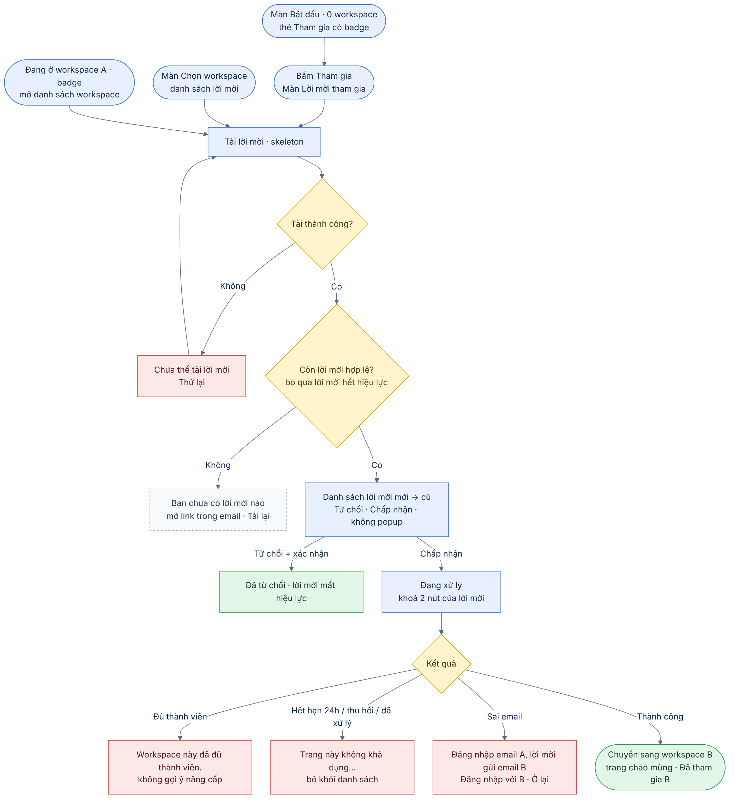
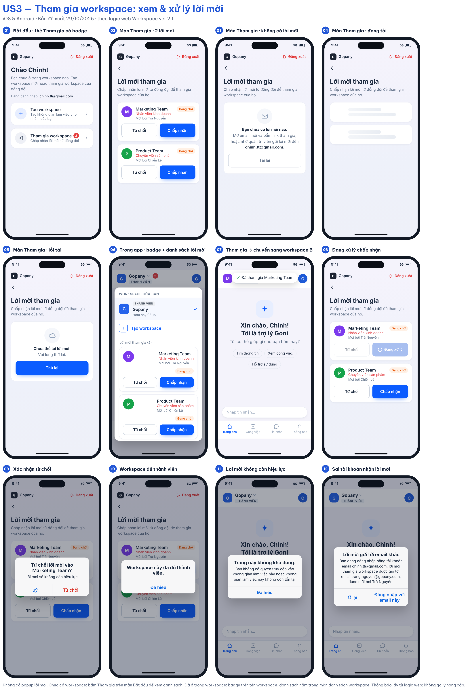

# 03 [EPIC-WS] US3 – Tham gia workspace: xem và xử lý lời mời

> **Tóm tắt:** Xử lý lời mời bằng danh sách, không dùng popup: màn Lời mời tham gia (mở từ thẻ Tham gia trên màn Bắt đầu), màn Chọn workspace và danh sách workspace trong app (badge trên tên workspace); chấp nhận thì chuyển sang workspace được mời; từ chối thì lời mời mất hiệu lực; đầy đủ loading, rỗng, lỗi · **Nền tảng:** Android, iOS · **Wireframe:** `gopany-wireframe-workspace-mobile.html` · **Số AC:** 18 · **Priority:** High – đề xuất · **Logic web:** US-WS-05, 07B, 10, 11, 12, 15, A7 (không dùng popup – xem mục 1)

**Trạng thái:** Draft v2.4 (29/10/2026) – chờ PM review. Đã đối chiếu logic web *Workspace ver 2.1*.

## 1. Background

Design cũ có nhắc đến lời mời nhưng thiếu nơi xem rõ ràng. Hệ thống đã có dữ liệu và cơ chế chấp nhận/từ chối lời mời.

Trên web, người dùng tham gia workspace bằng cách mở email mời và bấm link. Hệ thống chưa có mã tham gia hay link dùng chung. Vì vậy trên mobile, "Tham gia workspace" nghĩa là **xử lý lời mời đang chờ**, hoặc nếu chưa có thì **hướng dẫn mở link trong email / nhờ Admin mời**. Không cần backend mới.

**Logic web áp dụng cho app (Workspace ver 2.1):**

* Web: đang ở workspace A mà có lời mời vào workspace B → popup xác nhận trên trang thao tác (A7). **App: không dùng popup** (quyết định 29/10); lời mời hiển thị trong danh sách workspace kèm badge. Đồng ý → chuyển sang workspace B ở trang chào mừng. Không đồng ý → ở lại, **lời mời không còn hiệu lực** (A7, US-WS-10).
* Web: tải lại trang mà còn lời mời → hiện lại popup (US-WS-12, US-WS-14). **App:** lời mời còn hiệu lực vẫn nằm trong danh sách và badge sau mỗi lần mở/quay lại app; chưa thao tác thì không tự tham gia.
* Nhiều lời mời → danh sách sắp xếp **từ mới đến cũ**; lời mời không còn hiệu lực không hiển thị (US-WS-13 áp dụng cho thứ tự, không áp dụng popup lần lượt).
* Lời mời hiệu lực **24 giờ**. Hết hạn, thu hồi, workspace không tồn tại hoặc đã xử lý → "Trang này không khả dụng. Bạn không có quyền truy cập vào không gian làm việc này hoặc không gian làm việc này không còn tồn tại" (US-WS-12, US-WS-15).
* Đăng nhập sai email nhận lời mời → thông báo email A/B và người mời; chọn đăng nhập với email B hoặc ở lại (US-WS-11).
* Tham gia thành công → workspace mới xuất hiện ngay trong danh sách để chuyển qua lại; không gửi mật khẩu mới (US-WS-07B, A26).

**Vị trí hiển thị lời mời trên app:**

| Trạng thái người dùng | Cách hiển thị | Ghi chú |
|-----------------------|---------------|---------|
| Chưa có workspace (màn Bắt đầu) | Màn Bắt đầu **không** hiển thị danh sách; thẻ Tham gia có badge số lời mời. Bấm thẻ Tham gia → **màn Tham gia workspace** chứa danh sách lời mời | Thay cho popup của web; hành động và thông báo giữ như web |
| Có ≥ 2 workspace (màn Chọn workspace) | Danh sách lời mời dưới danh sách workspace | Theo hiện trạng (anh Chiến) |
| Đang ở trong một workspace | Badge số lời mời trên tên workspace; mở danh sách workspace thấy mục **Lời mời tham gia** với Chấp nhận/Từ chối. **Không bật popup** | Khác web (web dùng popup) – quyết định 29/10 |

## 2. User Story

Là **người được mời vào workspace**, tôi muốn **thấy lời mời ngay trong app và chấp nhận hoặc từ chối**, để **tham gia đúng workspace mà không phải tự tạo workspace mới**.

## 3. Scope

**Trong phạm vi:** Thẻ Tham gia workspace trên màn Bắt đầu; màn Lời mời tham gia chứa danh sách lời mời; danh sách lời mời tại màn Chọn workspace và danh sách workspace trong app, badge số lời mời; trạng thái không có lời mời kèm hướng dẫn; chấp nhận/từ chối bằng cơ chế hiện có; chuyển workspace sau khi chấp nhận; lời mời không còn hiệu lực, sai tài khoản; loading, rỗng, lỗi và thử lại.

**Ngoài phạm vi:** Popup xác nhận lời mời tự bật (web A7/US-WS-12/13/14); tạo/gửi lời mời (US2, Nhân sự, SĐCCTC); mã/link tham gia dùng chung; màn tạo mật khẩu và kích hoạt nhanh (US-WS-06, 07A – luồng đăng nhập); thay đổi giới hạn thành viên, gói; chia sẻ Zalo; phương thức xác thực mới.

## 4. User flow

 

## 5. Wireframe

 

| Màn/trạng thái | Nội dung |
|----------------|----------|
| Thẻ Tham gia trên màn Bắt đầu | "Tham gia workspace" – "Chấp nhận lời mời từ đồng đội". Badge số lời mời nếu > 0. Bấm vào mở màn Tham gia workspace. Màn Bắt đầu không hiển thị danh sách lời mời. |
| Màn Lời mời tham gia (mở từ thẻ Tham gia workspace) | Thanh trên cùng: logo **Gopany** bên trái, **Đăng xuất** (chữ đỏ, có icon) bên phải. Nút quay lại về màn Bắt đầu; tiêu đề "Lời mời tham gia"; mô tả "Chấp nhận lời mời từ đồng đội để tham gia workspace của họ."; danh sách thẻ lời mời hoặc trạng thái không có lời mời. |
| Thẻ lời mời | Mỗi lời mời là một thẻ riêng: avatar tròn, tên workspace, **chức vụ được gán** (chữ đỏ, theo A27), "Mời bởi {người mời}", nhãn **Đang chờ** (cam) góc phải; hai nút **Từ chối** (viền) và **Chấp nhận** (nền xanh). Mới nhất lên đầu. |
| Trong app (đang ở trong workspace) | Badge đỏ số lời mời cạnh tên workspace trên thanh trên cùng; bấm tên workspace mở danh sách workspace, mục **Lời mời tham gia** dùng cùng thẻ lời mời. Không có popup tự bật. |
| Không có lời mời | Minh hoạ phong bì; "Bạn chưa có lời mời nào."; "Mở email mời và bấm link tham gia, hoặc nhờ quản trị viên gửi lời mời đến **{email đang đăng nhập}**."; nút **Tải lại**. |
| Đang tải | Skeleton 2 dòng tại khu vực lời mời. |
| Lỗi tải | "Chưa thể tải lời mời." + nút **Thử lại**. Không hiển thị như rỗng. |
| Đang xử lý | Nút đã bấm hiện spinner, cả hai nút của lời mời đó disable. |
| Từ chối từ danh sách | Hộp xác nhận "Từ chối lời mời vào {tên}?" – "Lời mời sẽ không còn hiệu lực." – Huỷ / Từ chối. |
| Chấp nhận thành công | Chuyển sang workspace vừa tham gia, mở trang chào mừng (Trợ lý Goni – chờ Q10), thông báo "Đã tham gia {tên}". |
| Đủ thành viên | "Workspace này đã đủ thành viên." – **Đã hiểu**. Không có gợi ý nâng cấp. |
| Không còn hiệu lực | "Trang này không khả dụng. Bạn không có quyền truy cập vào không gian làm việc này hoặc không gian làm việc này không còn tồn tại" – **Đã hiểu**; lời mời bị bỏ khỏi danh sách. |
| Sai tài khoản | "Bạn đang đăng nhập bằng tài khoản email {A}, lời mời tham gia workspace được gửi tới email {B}, được mời bởi {người mời}." – **Đăng nhập với {B}** / **Ở lại**. |

## 6. Business Rules

| Mã  | Quy tắc |
|-----|---------|
| BR1 | Lời mời chưa xử lý hiển thị dạng danh sách tại: màn Lời mời tham gia (mở từ thẻ Tham gia trên màn Bắt đầu), màn Chọn workspace, danh sách workspace trong app. App không dùng popup tự bật. |
| BR2 | Lời mời tương ứng tài khoản nhận; không thêm workspace vào sai tài khoản. Sai email thì hiển thị thông báo US-WS-11 và cho chọn đăng nhập với email được mời hoặc ở lại. |
| BR3 | Mọi vị trí đều hỗ trợ Chấp nhận/Từ chối bằng cơ chế hiện có. Từ chối có bước xác nhận. |
| BR4 | Chưa xử lý lời mời thì không tự động tham gia workspace. |
| BR5 | Tham gia thành công bổ sung workspace vào tài khoản hiện có, không gửi mật khẩu mới; workspace xuất hiện ngay trong danh sách; quyền theo chức vụ được gán (US-WS-07B, A26). |
| BR6 | Chấp nhận thành công ở bất kỳ vị trí nào → cập nhật workspace hiện hành sang workspace vừa tham gia và mở trang chào mừng (A7, US-WS-10). |
| BR7 | Từ chối → người dùng ở lại màn/workspace hiện tại; lời mời không còn hiệu lực. Mở lại link mời đó hiển thị thông báo không khả dụng (A7). |
| BR8 | Nhiều lời mời: danh sách sắp xếp từ mới đến cũ; lời mời không còn hiệu lực không hiển thị (US-WS-13). |
| BR9 | Đang ở trong workspace mà có lời mời: hiển thị badge số lời mời trên tên workspace; mở app/quay lại app thì cập nhật badge và danh sách. Không bật popup. |
| BR10 | Lời mời hiệu lực 24 giờ. Hết hạn, thu hồi, workspace không tồn tại hoặc đã xử lý → không cho tham gia, không tạo workspace, hiển thị câu thông báo không khả dụng của web (US-WS-15). |
| BR11 | Đang xử lý thì vô hiệu hoá thao tác tại lời mời tương ứng để tránh gửi lặp. |
| BR12 | Chỉ hiển thị rỗng khi tải thành công và không có lời mời; lỗi tải có trạng thái riêng. Lỗi tải có Thử lại; sau lỗi xử lý, cập nhật trạng thái hiện tại trước khi cho thử lại. |
| BR13 | Lời mời đã xử lý không tiếp tục hiển thị như đang chờ ở vị trí khác. Danh sách tải lại khi app quay lại foreground (người dùng vừa bấm link trong email). |
| BR14 | Chưa có workspace Admin thì vẫn có điểm vào Tạo workspace theo US1 tại màn Bắt đầu, màn Chọn workspace và switcher. Không bắt buộc tạo trước khi tham gia. |
| BR15 | Thông báo đủ thành viên/không khả dụng không có gợi ý nâng cấp, gói hay link thanh toán. |

## 7. Acceptance Criteria

*Nội dung thông báo lấy từ logic web khi có; nội dung còn lại là đề xuất, cần duyệt trước nghiệm thu.*

| Mã  | Tình huống | Kết quả mong đợi |
|-----|------------|------------------|
| AC1 | Chưa có workspace, có lời mời chưa xử lý | Màn Bắt đầu hiển thị thẻ Tham gia có badge số lời mời; không hiển thị danh sách lời mời và không bật popup. |
| AC2 | Bấm thẻ Tham gia workspace | Mở màn Tham gia workspace: danh sách lời mời mới nhất trước, mỗi lời mời có Chấp nhận/Từ chối; nút quay lại về màn Bắt đầu. |
| AC3 | Chưa có workspace, không có lời mời, mở màn Tham gia workspace | Màn hiển thị hướng dẫn mở link trong email, có email đang đăng nhập, và nút Tải lại. |
| AC4 | Đang ở trong workspace A, có lời mời hợp lệ vào workspace B | Không bật popup; tên workspace có badge số lời mời; mở danh sách workspace thấy mục Lời mời tham gia với Chấp nhận/Từ chối. |
| AC5 | Có từ 2 lời mời hợp lệ | Danh sách hiển thị đủ các lời mời, mới nhất lên đầu; badge đúng số lượng. |
| AC6 | Mở lại app khi vẫn còn lời mời chưa xử lý | Không bật popup; badge và danh sách vẫn hiển thị lời mời còn hiệu lực; không tự tham gia. |
| AC7 | Đang tải dữ liệu lời mời | Skeleton; chưa kết luận không có lời mời. |
| AC8 | Tải lời mời thất bại | "Chưa thể tải lời mời." và nút Thử lại (đề xuất); không dùng trạng thái rỗng thay lỗi. |
| AC9 | Chấp nhận thành công từ màn Tham gia workspace hoặc màn Chọn workspace | Vào thẳng workspace vừa tham gia, mở trang chào mừng. |
| AC10 | Chấp nhận thành công từ switcher | Chuyển sang workspace vừa tham gia, mở trang chào mừng (không ở lại workspace cũ). |
| AC11 | Bấm Từ chối trong danh sách | Hộp xác nhận; Huỷ thì không đổi; Từ chối thì lời mời biến mất, thông báo "Đã từ chối lời mời". |
| AC12 | Chấp nhận nhưng workspace đã đủ thành viên | Không cho tham gia; "Workspace này đã đủ thành viên." Không có gợi ý nâng cấp. |
| AC13 | Lời mời quá 24 giờ, bị thu hồi, đã xử lý hoặc workspace không tồn tại | Không cho tham gia; "Trang này không khả dụng. Bạn không có quyền truy cập vào không gian làm việc này hoặc không gian làm việc này không còn tồn tại"; lời mời bị bỏ khỏi danh sách. |
| AC14 | Đăng nhập bằng email A, mở lời mời gửi tới email B | "Bạn đang đăng nhập bằng tài khoản email A, lời mời tham gia workspace được gửi tới email B, được mời bởi …"; chọn Đăng nhập với B (đăng xuất rồi về màn đăng nhập) hoặc Ở lại (không thay đổi gì). |
| AC15 | Đang xử lý hoặc thao tác gặp lỗi | Vô hiệu hoá nút tương ứng; lỗi có thông báo; Thử lại không tự chấp nhận hoặc thêm thành viên lặp. |
| AC16 | Đã xử lý lời mời tại một vị trí rồi mở vị trí khác | Lời mời đã xử lý không xuất hiện như đang chờ. |
| AC17 | Ở màn Bắt đầu hoặc màn Tham gia workspace, người dùng rời app bấm link mời trong email rồi quay lại | App tải lại; nếu đã tham gia qua link thì điều hướng theo US4 (vào workspace). |
| AC18 | Chưa có workspace Admin, đang xem lời mời | Vẫn thấy điểm vào Tạo workspace theo US1 tại màn Bắt đầu, màn Chọn workspace và switcher. |

## 8. Open Questions

1. Tài khoản đăng ký bằng SĐT chưa có email có nhận được lời mời không? Nếu không, hướng dẫn ở trạng thái rỗng cần nhắc bổ sung email. (Q3)
2. Link mời mở trên điện thoại sẽ mở app (deep link) hay web? (Q4)
3. "Trang chào mừng" của web tương ứng màn nào trên app? Đề xuất: Trợ lý Goni. (Q10)
4. App không dùng popup lời mời như web (A7, US-WS-12/13/14), chỉ dùng danh sách + badge – PM xác nhận. (Q11)

## 9. Lịch sử thay đổi

| Ngày | Nội dung thay đổi |
|------|-------------------|
| 21/10/2026 | Draft v1 |
| 29/10/2026 | Draft v2: thêm thẻ Tham gia trên màn Bắt đầu và trạng thái hướng dẫn mở link email; thêm switcher + badge; xác nhận từ chối; đề xuất điều hướng sau chấp nhận; tải lại khi quay lại app; sửa tham chiếu nút Tạo sang US1 |
| 29/10/2026 | Draft v2.1: đối chiếu logic web – popup xác nhận lần lượt mới → cũ khi đang ở trong workspace; chấp nhận thì chuyển sang workspace được mời; từ chối thì lời mời mất hiệu lực; hiện lại popup khi mở lại app; câu thông báo không khả dụng và sai tài khoản theo web; hiệu lực 24 giờ |
| 29/10/2026 | Draft v2.2: bỏ danh sách lời mời khỏi màn Bắt đầu; bấm thẻ Tham gia mở màn Tham gia workspace chứa danh sách; sửa AC1–AC3, AC12, AC20 |
| 29/10/2026 | Draft v2.3: làm lại wireframe theo design tham khảo – thẻ lời mời hiện chức vụ, người mời, nhãn Đang chờ; màn Lời mời tham gia có thanh logo + Đăng xuất |
| 29/10/2026 | Draft v2.4: bỏ popup xác nhận lời mời tự bật và hiển thị lần lượt; lời mời trong app chỉ hiện ở danh sách workspace kèm badge; bỏ 3 AC về popup, đánh số lại AC (còn 18) |
